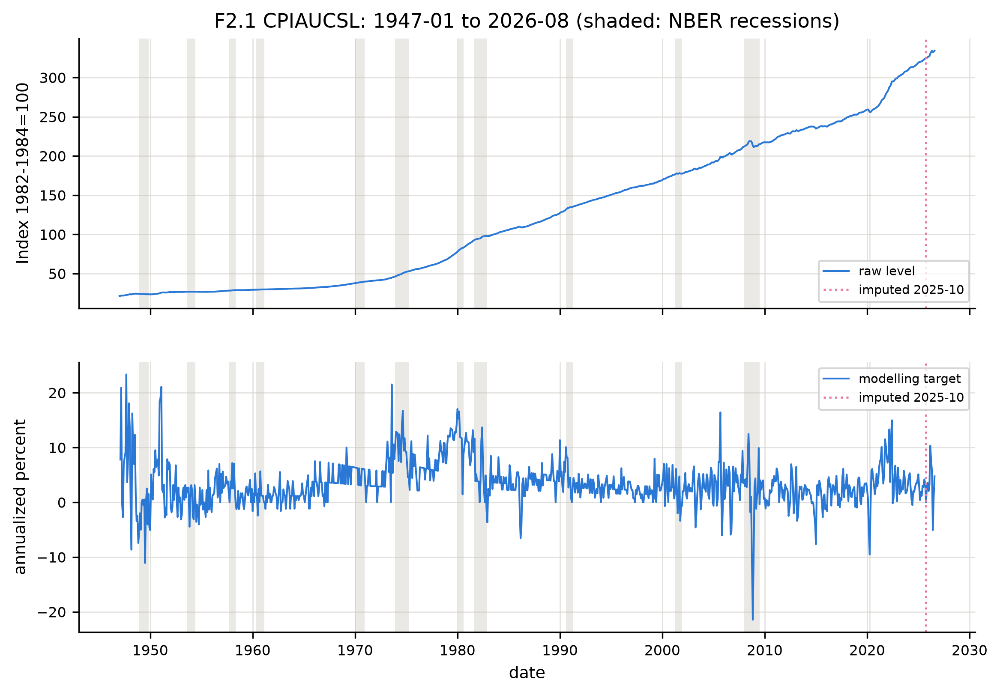

# Appendix A. Data Definitions, Transformations, and Supplementary Diagnostic Evidence

This appendix supports the definitions and diagnostic decisions in Sections 2.2–2.4 and the empirical screening in Section 3.1. It provides verifiable numerical detail without displacing the central methodology or the findings from the main chapters. The indicators are U.S. official macroeconomic statistics accessed through the historical frozen collection of 5 October 2026, with the explicitly documented local carry-forward treatment. A historical pseudo-out-of-sample sample is **not** a reconstruction of every originally published real-time vintage.

## A.1 Official variables, units and usable dates

**Table A.1. Data dictionary and actual available observation periods**

| Target | Frequency | Official concept and units | Raw observed span | Modelled transformed span | Baseline transformation |
|---|---|---|---|---|---|
| GDPC1 | Q | Billions of Chained 2017 Dollars; SAAR | 1947-01 to 2026-04 | 1947-04 to 2026-04 | 400 x dlog |
| CPIAUCSL | M | Index 1982-1984=100; SA | 1947-01 to 2026-08 | 1947-02 to 2026-08 | 1200 x dlog |
| UNRATE | M | Percent; SA | 1948-01 to 2026-09 | 1948-01 to 2026-08 | level (no transformation) |
| INDPRO | M | Index 2017=100; SA | 1919-01 to 2026-08 | 1947-02 to 2026-08 | 1200 x dlog |
| FEDFUNDS | M | Percent; NSA | 1954-07 to 2026-09 | 1954-08 to 2026-08 | first difference |
| M2SL | M | Billions of Dollars; SA | 1959-01 to 2026-08 | 1959-02 to 2026-08 | 1200 x dlog |

*Source: Author's computations from Bureau of Economic Analysis, Bureau of Labor Statistics, Board of Governors of the Federal Reserve System, and FRED/ALFRED observations, as applicable.* *Note:* M denotes monthly, Q quarterly, SA seasonally adjusted and SAAR seasonally adjusted at an annual rate. Date spans refer to the original source series and then to the *transformed series retained for analysis*; they should not be confused with the shorter dates of the rolling forecast evaluation. UNRATE's source may contain an additional month after the common analysis endpoint, which is not used for the declared forecasts.

The baseline transformations are defined consistently as follows. For positive monthly level series (X_t), annualized growth is (g_t=1200log(X_t/X_{t-1})). Quarterly annualized real GDP growth is (g_t^{GDP}=400log(GDPC1_t/GDPC1_{t-1})). The unemployment rate (u_t) remains in percentage-point levels, whereas the effective federal funds rate enters the principal forecast design through (Delta i_t=i_t-i_{t-1}). The log-growth scale is an annualized percentage approximation to the one-period rate, not a literal year-over-year inflation rate.

The CPI is the broad all-items Consumer Price Index for All Urban Consumers, not personal consumption expenditures inflation. Industrial production measures real production activity, not GDP. M2 is the official broad monetary aggregate as published for the observed sample; it is **not** a series ending in 1992. Its updated measurement history and monetary interpretation warrant care, but its available transformed values extend to the stated 2026 endpoint. The effective federal funds rate is an observed short-term policy-rate proxy, not the Federal Reserve's announced target rate, a theoretical real rate or a three-month Treasury bill rate. Their different institutional meanings are acknowledged in Chapter 2.

## A.2 Missing observations in October 2025

The frozen source did not supply two October 2025 observations. The analysis preserved the historical endpoint by creating **author-processed** local carry-forward levels from September 2025. These replacement cells are not relabelled as official data.

**Table A.2. Explicitly constructed historical levels**

| Series | Missing month | Previous observed month | Previous observed value | Author-constructed October level | Official October value? |
|---|---|---|---:|---:|---|
| CPIAUCSL | 2025-10 | 2025-09 | 324.245 | 324.245 | No |
| UNRATE | 2025-10 | 2025-09 | 4.4 | 4.4 | No |

*Source: Author's computations and missing-observation record.* *Note:* The CPI level carry-forward produces a zero October 2025 log change and affects the following log-difference comparison; the unemployment value is in levels and is also used by subsequent lagged regressors. The directly affected realized CPI growth targets are October and November 2025. Indirect exposure can persist through lagged inputs and model-estimation windows. This imputation is an explicitly acknowledged modelling decision, not independent evidence of economic stability in October 2025.

The sensitivity of relative forecast accuracy to directly affected target dates is reported in Appendix C, Table C.8. Removing the directly affected realized targets does **not** eliminate all lag-vector and rolling-estimation exposure to the imputed inputs. The established full-sample analysis is therefore retained as the baseline, with its limitation stated.

**Figure A.1. CPI level, transformed inflation target and the October 2025 constructed observation**

*Source: Author's computations from U.S. Bureau of Labor Statistics data.* *Note:* The upper panel contains the observed index level, while the lower shows the annualized one-month log-change inflation target. Shaded recessions are retrospective dates. The dotted marker indicates the author-constructed October 2025 input, not an official publication. The plot illustrates variation in inflation and the data treatment; it does **not** test whether a 12-month autoregressive coefficient is statistically necessary or identify a seasonal mechanism. The relevant CPI lag comparison is reported in Section 4.3 and Appendix C, Table C.2.

## A.3 Unit-root, stationarity and break-sensitive supplementary results

**Table A.3. Unemployment and federal funds rate level tests**

| Series | Sample | Test and tested representation | Statistic | p-value | Decision at 5% |
|---|---|---|---:|---:|---|
| UNRATE | Initial 240-month window | ADF (level) | -3.12 | 0.0251 | reject |
| UNRATE | Initial 240-month window | KPSS (level) | 0.318 | 0.1 | do not reject |
| UNRATE | Initial 240-month window | ZA (level) | -4.556 | 0.1887 | do not reject |
| UNRATE | Full available level | ADF (level) | -3.806 | 0.0028 | reject |
| UNRATE | Full available level | KPSS (level) | 0.397 | 0.0783 | do not reject |
| UNRATE | Full available level | ZA (level) | -4.606 | 0.1691 | do not reject |
| FEDFUNDS | Initial 240-month window | ADF (level) | -0.063 | 0.953 | do not reject |
| FEDFUNDS | Initial 240-month window | KPSS (level) | 1.647 | 0.01 | reject |
| FEDFUNDS | Initial 240-month window | ZA (level) | -3.5 | 0.8113 | do not reject |
| FEDFUNDS | Full available level | ADF (level) | -2.448 | 0.1285 | do not reject |
| FEDFUNDS | Full available level | KPSS (level) | 1.253 | 0.01 | reject |
| FEDFUNDS | Full available level | ZA (level) | -4.29 | 0.3203 | do not reject |

*Source: Author's computations.* *Note:* ADF and ZA test a unit-root null under their stated deterministic terms; KPSS tests a stationarity null. “Reject” therefore has opposite directional implications for the ADF/ZA and KPSS tests. The ZA test permits one estimated endogenous break with trend/intercept terms as specified in the test design. Its non-rejection does not prove that no structural break occurred. Reported KPSS p-values can be bounded by tabulated approximation limits and should not be read as infinite-precision p-values. For both variables, the initially selected representation follows the predeclared ADF/KPSS rule; the ZA outcomes are disclosed as break-sensitive diagnostics, not silently substituted for that decision.

Unemployment is retained in levels because the initial-window ADF/KPSS decisions agree in the direction of level stationarity at the declared 5% criterion. The funds rate is differenced because the corresponding level tests indicate nonstationarity. The full-sample results and break-sensitive non-rejections qualify the diagnosis rather than establishing causal stationarity or irreversibility of either choice. Alternative transformations are evaluated in Chapter 4 and detailed in Appendix C.

## A.4 Nonlinearity diagnostics

**Table A.4. Six-target nonlinearity tests before nonlinear interpretation**

| Target | Tsay test, p | STAR linearity, selected delay | STAR p at selected delay | Transition selected | Rejection at 5%? |
|---|---:|---:|---:|---|---|
| GDPC1 | 0.2242 | 3 | 0.45411 | LSTAR | No |
| CPIAUCSL | 0.6213 | 6 | 2.43e-9 | LSTAR | Yes |
| UNRATE | 0.0013 | 1 | 3.18e-5 | LSTAR | Yes |
| INDPRO | 0.7011 | 4 | 0.07775 | ESTAR | No |
| FEDFUNDS | 0.8206 | 1 | 0.04324 | ESTAR | Yes |
| M2SL | 0.1422 | 5 | 0.12708 | LSTAR | No |

*Source: Author's computations.* *Note:* The Tsay test examines specified departures from a linear autoregressive conditional mean; the separate STAR procedure assesses a selected-delay smooth-transition alternative. These are different null tests. Their p-values do not validate an estimated MSAR regime or establish out-of-sample forecasting superiority. Selected delays are in the target's native monthly or quarterly periods.

The Tsay result rejects for unemployment, while the selected STAR linearity procedure rejects for unemployment, CPI and the policy-rate change. For other targets, a non-rejection is absence of test evidence against the relevant restriction, **not** proof of global linearity. The nonlinear model families remain in the declared forecasting comparison even when an initial screening test fails to reject, so the results are not selected retrospectively for significance.

## A.5 Model orders fixed before the principal forecast comparisons

**Table A.5. Baseline autoregressive and nonlinear order selections**

| Target | Selected AR order | ARMA candidate (p,q) | MSAR lag order | STAR lag, delay and type | AR initial-window residuals pass? |
|---|---:|---|---:|---|---|
| GDPC1 | 1 | (1,0) | 1 | 1, d=3, LSTAR | Yes |
| CPIAUCSL | 2 | (1,0) | 2 | 2, d=6, LSTAR | Yes |
| UNRATE | 6 | (3,4) | 4 | 4, d=1, LSTAR | Yes |
| INDPRO | 12 | (1,0) | 4 | 4, d=4, ESTAR | Yes |
| FEDFUNDS | 1 | (1,0) | 1 | 1, d=1, ESTAR | Yes |
| M2SL | 3 | (3,0) | 3 | 3, d=5, LSTAR | Yes |

*Source: Author's computations.* *Note:* The ARMA candidate family often chooses a zero moving-average order. Such a selected ARMA representation is technically a member of the ARMA class but is not evidence of an independently identified MA component. The additional ceiling on nonlinear autoregressive orders limits numerical complexity; it must not be confused with the longer order of the AR benchmark. “Residuals pass” records the initial-window primary whiteness screen, not a guarantee of full-sample adequacy.

Together, Tables A.1–A.5 allow the reader to inspect the contested unemployment/policy-rate transformation, the CPI model order and the status of monetary and activity variables. The corresponding residual diagnostics and fitted nonlinear parameter evidence appear in Appendix B, whereas Section 3.1 gives the inference required for the main argument.
