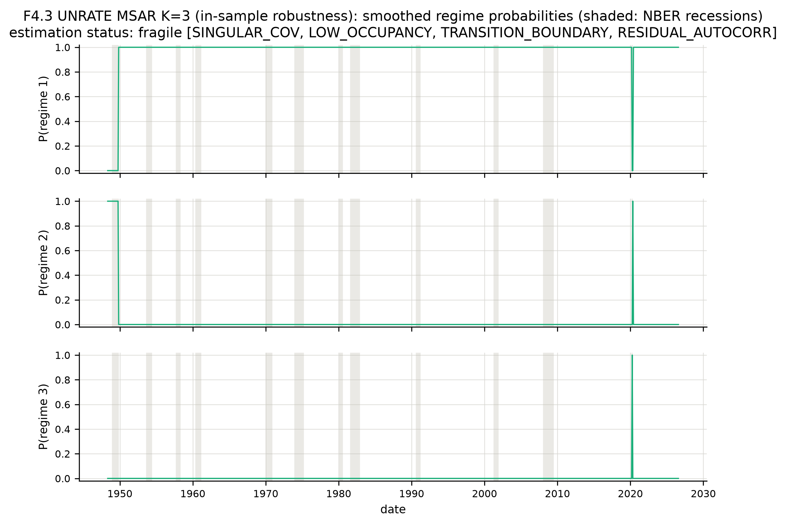

# Appendix C. Specification Robustness, Numerical Fragility, and Sensitive Forecast Comparisons

The robustness chapter tests whether the baseline finding survives reasonable alternative transformations, lag orders, state counts, forecast horizons, estimation windows and lagged cross-variable information. This appendix provides the corresponding empirical numerical contrasts. It is not a collection of newly estimated models: all values are taken from the same final frozen research results. Unless otherwise indicated, lower RMSE/MAE means a smaller descriptive error; formal superiority requires a separately supported loss comparison.

## C.1 Alternative unemployment and federal-funds-rate representations

**Table C.1. Alternative transformations, one-step forecast errors and matched HLZ comparisons**

| Target | Alternative representation | Model | Valid n | RMSE | MAE | HLZ p squared / absolute vs AR |
|---|---|---|---:|---:|---:|---|
| UNRATE | difference | AR | 701.0 | 0.563 | 0.166 | — |
| UNRATE | difference | ARMA | 696.0 | 0.680 | 0.176 | 0.3470 / 0.7080 |
| UNRATE | difference | MSAR | 703.0 | 0.776 | 0.174 | 0.3200 / 0.2620 |
| UNRATE | difference | STAR | 703.0 | 20.747 | 0.952 | 0.4611 / 0.6921 |
| FEDFUNDS | level | AR | 555.0 | 0.426 | 0.216 | — |
| FEDFUNDS | level | ARMA | 620.0 | 0.520 | 0.224 | 0.8084 / 0.1461 |
| FEDFUNDS | level | MSAR | 577.0 | 0.456 | 0.219 | 0.2369 / 0.1452 |
| FEDFUNDS | level | STAR | 626.0 | 0.974 | 0.276 | 0.1413 / 0.1017 |

*Source: Author's computations.* *Note:* The unemployment alternative is the first difference and the policy-rate alternative is the rate level. These correspond to **different target definitions** and therefore must not be compared with the baseline transformation by simply comparing their RMSE magnitudes. A p-value belongs to the matched model-versus-AR comparison **within the same transformation**. Neither alternative provides a significant positive MSAR or STAR gain under the primary test. The secondary DM–HLN tests may disagree and do not replace the primary decision.

## C.2 CPI lag-order alternatives

**Table C.2. CPI AR-lag robustness**

| CPI lag order | Valid n | Failed fits | RMSE | MAE | OOS R² vs AR(1) |
|---|---:|---:|---:|---:|---:|
| AR(p=1) | 714 | 0 | 3.075 | 2.194 | 0.0000 |
| AR(p=3) | 714 | 0 | 2.958 | 2.072 | 0.0747 |
| AR(p=6) | 714 | 0 | 2.969 | 2.093 | 0.0678 |
| AR(p=12) | 714 | 0 | 2.967 | 2.080 | 0.0688 |

*Source: Author's computations.* *Note:* The approved AR(2) benchmark is reported in the main text and is **not** one of these four re-fitted alternative-order rows. The direct formal tests accompanying the lag variants compare the alternatives with AR(1), not AR(2) with AR(12). The presence of a 12-month lag alone does not prove monthly seasonality, and a numerical difference in RMSE is not a direct significance or equivalence test.

## C.3 Three-state versus two-state MSAR estimates

**Table C.3. Full-sample regime-count assessment across the six targets**

| Target | K=2 BIC | K=3 BIC | K=3 − K=2 | K=3 fit classification | Credible additional state? |
|---|---:|---:|---:|---|---|
| GDPC1 | 1775.04 | 1744.68 | -30.36 | fragile: SINGULAR_COV;LOW_OCCUPANCY;TRANSITION_BOUNDARY | No |
| CPIAUCSL | 4879.14 | 4823.33 | -55.81 | fragile: LOW_OCCUPANCY;RESIDUAL_AUTOCORR | No |
| UNRATE | -142.46 | 68.08 | 210.54 | fragile: SINGULAR_COV;LOW_OCCUPANCY;TRANSITION_BOUNDARY;RESIDUAL_AUTOCORR | No (likelihood comparison inconclusive) |
| INDPRO | 7289.93 | 7222.55 | -67.37 | fragile: SINGULAR_COV;LOW_OCCUPANCY;TRANSITION_BOUNDARY;RESIDUAL_AUTOCORR | No |
| FEDFUNDS | 1078.36 | 581.20 | -497.16 | fragile: LOW_OCCUPANCY;TRANSITION_BOUNDARY;RESIDUAL_AUTOCORR | No |
| M2SL | 4460.85 | 4390.07 | -70.78 | fragile: LOW_OCCUPANCY;TRANSITION_BOUNDARY;RESIDUAL_AUTOCORR | No |

*Source: Author's computations.* *Note:* The K=3 model is estimated solely for retrospective **in-sample regime credibility**, never as an out-of-sample challenger. A lower BIC can accompany regimes supported by only one or two observations, boundary transitions or unusable standard errors. For unemployment, the three-state obtained log-likelihood is below the two-state value despite the additional flexibility, so the **likelihood-based regime-count comparison is inconclusive**. It does not establish K=2 optimality or identify a global optimum. Chapter 4 reports the CPI three-state fitted equation and its uncertainty.

**Figure C.1. Fragile three-state unemployment probabilities**

*Source: Author's computations.* *Note:* These are retrospective smoothed probabilities from a numerically fragile fit; the drawing is not an independently validated economic phase classification. Near-degenerate probabilities and the associated unusable covariance are part of the result.

## C.4 Forecast-horizon robustness

**Table C.4. AR and MSAR relative forecast accuracy across all declared horizons**

| Target | Forecast horizon | AR RMSE | MSAR RMSE | MSAR OOS R² vs AR | HLZ p squared / absolute |
|---|---:|---:|---:|---:|---|
| GDPC1 | 1 | 5.284 | 4.447 | 0.2917 | 0.3566 / 0.6261 |
| GDPC1 | 2 | 4.601 | 4.393 | 0.0883 | 0.3727 / 0.4606 |
| GDPC1 | 4 | 4.459 | 4.348 | 0.0492 | 0.4253 / 0.5215 |
| CPIAUCSL | 1 | 2.967 | 2.966 | 0.0003 | 0.9750 / 0.3980 |
| CPIAUCSL | 3 | 3.460 | 3.473 | -0.0074 | 0.7065 / 0.3792 |
| CPIAUCSL | 6 | 3.656 | 3.628 | 0.0150 | 0.3564 / 0.1691 |
| CPIAUCSL | 12 | 3.949 | 3.865 | 0.0422 | 0.0329 / 0.0044 |
| UNRATE | 1 | 0.551 | 0.491 | 0.1890 | 0.3669 / 0.3217 |
| UNRATE | 3 | 0.942 | 1.064 | -0.1291 | 0.3773 / 0.9098 |
| UNRATE | 6 | 1.165 | 1.410 | -0.5377 | 0.3158 / 0.2231 |
| UNRATE | 12 | 1.492 | 2.075 | -0.9522 | 0.3020 / 0.1576 |
| INDPRO | 1 | 13.311 | 11.638 | 0.2355 | 0.2317 / 0.1212 |
| INDPRO | 3 | 13.273 | 12.126 | 0.1654 | 0.2677 / 0.2071 |
| INDPRO | 6 | 12.663 | 12.111 | 0.0852 | 0.2939 / 0.5161 |
| INDPRO | 12 | 12.140 | 12.147 | -0.0012 | 0.9801 / 0.6547 |
| FEDFUNDS | 1 | 0.475 | 0.480 | -0.0194 | 0.4989 / 0.9868 |
| FEDFUNDS | 3 | 0.518 | 0.516 | 0.0093 | 0.2807 / 0.6697 |
| FEDFUNDS | 6 | 0.512 | 0.511 | 0.0033 | 0.1878 / 0.9698 |
| FEDFUNDS | 12 | 0.510 | 0.510 | -0.0003 | 0.6948 / 0.1710 |
| M2SL | 1 | 5.077 | 5.127 | -0.0197 | 0.2364 / 0.8711 |
| M2SL | 3 | 6.124 | 6.447 | -0.1080 | 0.3864 / 0.7233 |
| M2SL | 6 | 6.108 | 6.365 | -0.0859 | 0.3740 / 0.9940 |
| M2SL | 12 | 6.216 | 6.311 | -0.0307 | 0.2904 / 0.3367 |

*Source: Author's computations.* *Note:* GDP horizons are in quarters; other horizons are in months. OOS (R^2) uses AR-matched dates within each horizon, whereas displayed RMSEs are based on each model's own valid forecasts. Horizons can have different admissible target-date calendars. The CPI twelve-month nominal MSAR result is not evidence of systematic gain: the supplementary 46-comparison Holm sensitivity removes its two unadjusted rejections. That adjustment is a sensitivity analysis rather than a predeclared primary test.

## C.5 Information from other macroeconomic variables

**Table C.5. Five-variable monthly VAR relative to univariate models**

| Target | VAR-comparison common n | AR RMSE | MSAR RMSE | VAR RMSE | VAR vs AR HLZ p squared / absolute |
|---|---:|---:|---:|---:|---|
| CPIAUCSL | 544 | 2.925 | 2.936 | 3.011 | 0.1470 / 0.0662 |
| UNRATE | 527 | 0.613 | 0.550 | 0.493 | 0.3464 / 0.8107 |
| INDPRO | 544 | 14.207 | 12.196 | 12.983 | 0.3460 / 0.5569 |
| FEDFUNDS | 538 | 0.484 | 0.491 | 0.498 | 0.4549 / 0.0036 |
| M2SL | 544 | 5.052 | 5.084 | 4.820 | 0.4755 / 0.4072 |

*Source: Author's computations.* *Note:* These are strictly **common-date** estimates for the five monthly targets, after enforcing VAR stability and requiring available forecasts from all candidate models. GDP is quarterly and is not part of this VAR. The general VAR(1) and its initial-window fitted coefficient matrix are in Section 4.6. This comparison tests whether the selected lagged cross-variable information alters predictive accuracy; it is not a structural model of causal macroeconomic transmission.

## C.6 Conditional variance as an alternative source of model misspecification

**Table C.6. Selected GARCH diagnostic results**

| Target | Rolling variance-model fits | Mean ARCH+GARCH persistence | Standardized residual ARCH-LM rejection share | GARCH mean-forecast RMSE | Included in primary ranking? |
|---|---:|---:|---:|---:|---|
| CPIAUCSL | 688 of 688 | 0.829 | 0.000 | 2.817 | No |
| UNRATE | 689 of 689 | 0.555 | 0.261 | 0.457 | No |
| FEDFUNDS | 505 of 505 | 0.968 | 0.028 | 0.323 | No |

*Source: Author's computations.* *Note:* These experiments respond to residual ARCH evidence in CPI, unemployment and the federal funds rate. GARCH is used as a **conditional-variance diagnostic**, not introduced into the predeclared AR/ARMA/MSAR/STAR ranking or the Model Confidence Set. Lower RMSE for a GARCH variant is therefore not an approved primary claim of mean-forecast superiority. The persistence statistic is the mean of fitted ARCH plus GARCH coefficients over rolling origins, not a single full-sample estimate.

## C.7 Model availability and fitting status

**Table C.7. Classified estimation records by target and family**

| Target | Model | Adequate fits | Fragile fits | Failed fits | Total classified fits |
|---|---|---:|---:|---:|---:|
| GDPC1 | AR | 785 | 4 | 0 | 789 |
| GDPC1 | ARMA | 785 | 4 | 0 | 789 |
| GDPC1 | MSAR | 238 | 551 | 0 | 789 |
| GDPC1 | STAR | 38 | 751 | 0 | 789 |
| CPIAUCSL | AR | 5,719 | 1 | 1 | 5,721 |
| CPIAUCSL | ARMA | 2,860 | 1 | 0 | 2,861 |
| CPIAUCSL | MSAR | 1,080 | 1,781 | 0 | 2,861 |
| CPIAUCSL | STAR | 545 | 2,316 | 0 | 2,861 |
| UNRATE | AR | 3,509 | 5 | 6 | 3,520 |
| UNRATE | ARMA | 3,437 | 11 | 72 | 3,520 |
| UNRATE | MSAR | 2,120 | 1,380 | 20 | 3,520 |
| UNRATE | STAR | 345 | 3,175 | 0 | 3,520 |
| INDPRO | AR | 2,857 | 4 | 0 | 2,861 |
| INDPRO | ARMA | 2,856 | 5 | 0 | 2,861 |
| INDPRO | MSAR | 985 | 1,876 | 0 | 2,861 |
| INDPRO | STAR | 1,131 | 1,730 | 0 | 2,861 |
| FEDFUNDS | AR | 3,055 | 1 | 71 | 3,127 |
| FEDFUNDS | ARMA | 3,099 | 1 | 27 | 3,127 |
| FEDFUNDS | MSAR | 665 | 2,413 | 49 | 3,127 |
| FEDFUNDS | STAR | 538 | 2,589 | 0 | 3,127 |
| M2SL | AR | 2,279 | 6 | 0 | 2,285 |
| M2SL | ARMA | 2,280 | 5 | 0 | 2,285 |
| M2SL | MSAR | 40 | 2,245 | 0 | 2,285 |
| M2SL | STAR | 144 | 2,141 | 0 | 2,285 |

*Source: Author's computations.* *Note:* Each entry counts a **classified fit record**. A fit can be numerically retained but fragile. The much larger *diagnostic reason-code event registry* records warnings and can have multiple events per fit; it is not a count of unique model failures. A separate statement about reason-code events must use its own denominator. Consequently, the percentages in this table and in Chapter 4 refer to fit records, not an aggregate of multiple flags on the same estimate.

The unemployment MSAR chain contrasts with the pooled predominance of fragile nonlinear fits: a sizeable subset of its fitted records is adequate, whereas other series have frequent state-occupancy and numerical issues. Pooled MSAR/STAR rates must therefore not be imposed mechanically on each target. The practical limitation is especially acute when error scoring excludes failed forecasts or when some retained forecasts are finite but economically extreme.

## C.8 The pre-October-2025 sensitivity calendar

**Table C.8. Full baseline versus evaluation ending before the October 2025 gap**

| Target | Model | Full n | Full RMSE | Pre-gap n | Pre-gap RMSE |
|---|---|---:|---:|---:|---:|
| CPIAUCSL | AR | 715 | 2.967 | 704 | 2.950 |
| CPIAUCSL | ARMA | 715 | 3.075 | 704 | 3.059 |
| CPIAUCSL | MSAR | 715 | 2.966 | 704 | 2.951 |
| CPIAUCSL | STAR | 715 | 5.380e+9 | 704 | 5.422e+9 |
| UNRATE | AR | 703 | 0.551 | 692 | 0.555 |
| UNRATE | ARMA | 689 | 0.737 | 678 | 0.742 |
| UNRATE | MSAR | 698 | 0.491 | 687 | 0.495 |
| UNRATE | STAR | 704 | 0.592 | 693 | 0.595 |

*Source: Author's computations.* *Note:* The pre-gap calendar ends **September 2025**; the full baseline extends to August 2026. These are different historical evaluation spans and therefore different scored samples, not a pure deletion of just two directly affected realized targets. The comparison checks whether the major descriptive conclusions change when all post-gap targets are excluded. It does **not** remove the effect of imputed values from all models in the full baseline, and it is not an alternative historical-vintage reconstruction. Directly constructed inputs are described in Appendix A, Table A.2.

## C.9 Estimation-window sensitivity

**Table C.9. Unemployment MSAR versus AR across three estimation-window lengths**

| UNRATE window length, months | AR RMSE | MSAR RMSE | MSAR vs AR OOS R² | MSAR vs AR HLZ p squared / absolute |
|---|---:|---:|---:|---|
| 180 | 0.603 | 0.517 | 0.240 | 0.3924 / 0.7743 |
| 240 | 0.574 | 0.512 | 0.190 | 0.3697 / 0.3334 |
| 300 | 0.558 | 0.819 | -1.102 | 0.3157 / 0.3026 |

*Source: Author's computations.* *Note:* All window-length results use the common eligible-date calendar defined by the longest candidate window, with additional paired-date restrictions when a fit is unavailable. The descriptive unemployment MSAR gain changes sharply with the estimation history, but the primary HLZ comparison does not establish a positive nonlinear gain at any of the three selected lengths. The window exercise does not determine a universally optimal fitting history.

## C.10 Alternative turning-window widths

**Table C.10. Illustration: unemployment turning-neighborhood sensitivity**

| Monthly turning width | UNRATE AR turning-window n | AR RMSE | MSAR turning-window n | MSAR RMSE |
|---|---:|---:|---:|---:|
| ±1 months | 46 | 1.545 | 45 | 1.671 |
| ±3 months | 105 | 1.080 | 102 | 1.216 |
| ±6 months | 176 | 1.066 | 173 | 0.945 |

*Source: Author's computations.* *Note:* The model errors are calculated for retrospectively identified turning neighborhoods. A change from ±1 to ±6 months changes the classification and number of scored dates; the resulting RMSEs do not measure forecasting the dates of turns. This table exemplifies the sensitivity examined across all targets and horizons; the complete state-conditioned tests support no stable, inferentially established nonlinear turning-point advantage.

The corrected two-panel forecast plots, including the unemployment display in Chapter 3 and CPI display in Chapter 4, preserve the ordinary forecast scale without suppressing flagged or extreme observations. Failed estimates remain unscored; extreme **finite** forecasts remain included in their applicable loss measures. The empirical evidence cannot be made more favorable by discarding difficult dates without a declared scoring rule.
