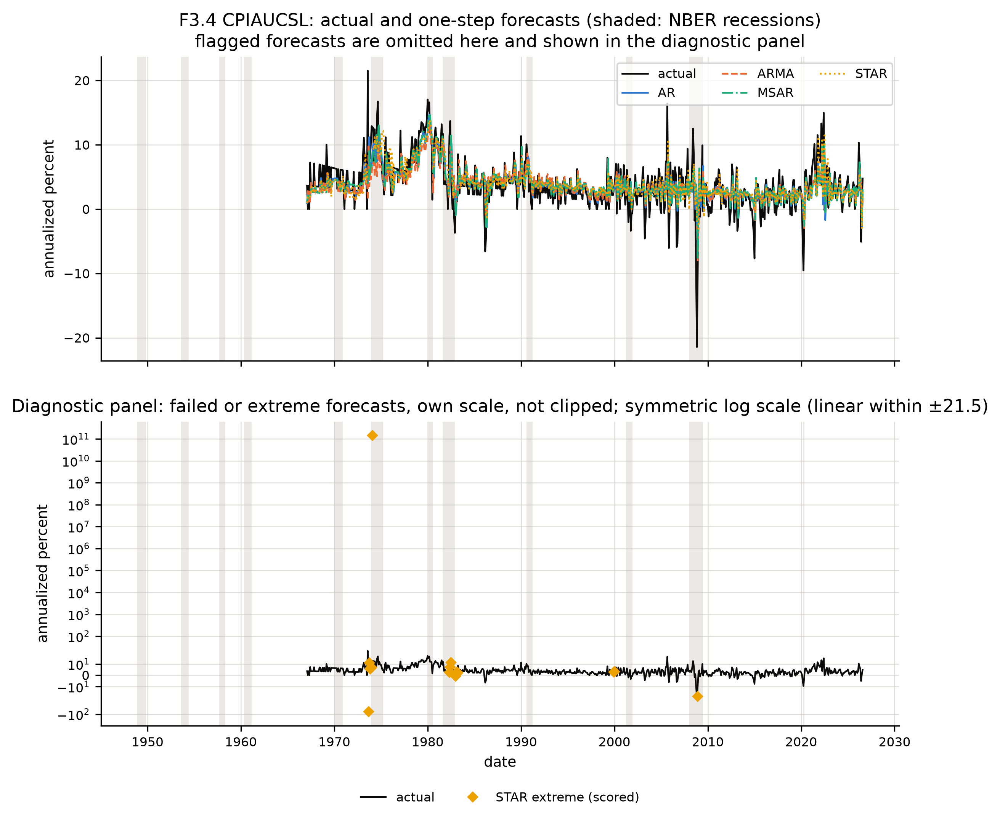

# Part II: Testing the Forecast Value of Nonlinear State Dependence

# Chapter 4: Do Nonlinear Forecast Gains Survive? Specification Robustness, Cross-Variable Dynamics and Policy Relevance

Chapter 3 established an important tension between the statistical description of macroeconomic instability and its practical value for forecasting. Nonlinear models sometimes fit the observed history more closely, and initial tests reject selected linear conditional-mean restrictions for unemployment, CPI inflation and changes in the federal funds rate. Yet no two-state Markov-switching autoregression (MSAR) significantly improves on the corresponding autoregressive (AR) benchmark at the one-step horizon under the primary Harvey–Leybourne–Zu test across the six U.S. targets. The most visible reductions in root mean squared error (RMSE), for real GDP and industrial production, occur in samples heavily affected by extraordinary pandemic observations. Other nonlinear estimates display sparse regimes, ill-conditioned parameter covariance matrices, nearly indistinguishable states or unstable forecasts.

These findings do not settle whether the negative general conclusion is robust. A forecasting comparison is conditional on its variable transformations, lag structure, estimation window, forecast distance, information set and treatment of numerical failures. If the linear benchmark is misspecified, nonlinear flexibility, including the smooth-transition alternatives discussed by Teräsvirta (1994), might appear to capture dependence that a better linear model would already use. If a rate is differenced unnecessarily, persistence might be lost; if it is retained in levels despite a unit root, apparent regimes could reflect stochastic trends. If a state-switching model is too restrictive, adding another state could reveal a credible process. Conversely, the extra parameters can multiply identification problems without delivering useful forecasts.

The purpose of this chapter is therefore not to search for a configuration that produces a preferred positive or negative answer. It is to confront the baseline inference with named alternative explanations and record whether its interpretation survives. The first six sections examine transformations, lag selection, regime count, horizon and cross-variable information. The second half addresses estimation-window choice, numerical fragility, the boundaries of real-time and mixed-frequency forecasting, and the economic and policy implications of the full evidence.

## 4.1 From Baseline Result to Falsification Test: The Threat-Based Robustness Framework

### 4.1.1 The baseline conclusion as a proposition open to challenge

The baseline experiment provides an observed statistical conclusion, not a proof about the true data-generating process. The null of equal average forecast accuracy was not rejected in favor of MSAR at the one-step horizon for any of the six targets under the declared primary test. It follows that a general nonlinear forecasting advantage has not been established. It does not follow that AR is always optimal, that the models have identical accuracy or that nonlinear macroeconomic mechanisms do not exist. A failure to reject an accuracy null may reflect small effects, volatile loss differentials, weak statistical power or an unsuitable model family.

A useful robustness exercise therefore challenges a precise alternative explanation. This chapter follows five questions in sequence: what the baseline claims, what could make that claim misleading, which specified comparison addresses the threat, what the resulting evidence shows, and how the conclusion changes. The final step is essential. If a model ranking changes but formal inference does not, the finding is *rank-sensitive*, not a statistically supported reversal. If a numerical optimizer returns a likelihood below that of a nested restricted model, the result is *inconclusive*, not evidence that the restricted specification is true. If a p-value changes after modifying the evaluation sample, the change must be associated with the new sample and not silently substituted for the original one.

A distinction is also required between the *robustness of an inference* and the *robustness of a model ranking*. Two specifications can have different RMSE orderings but yield the same non-rejection of equal average loss. A model can likewise rank first on its own valid dates while falling in a pairwise common-date comparison. The relevant objects are respectively the observed sample loss, the paired loss differential and the uncertainty attached to that differential. Their relationship was developed in Section 2.10 and demonstrated for unemployment in Section 3.4. An assertion about forecasting ability must identify which one supports it.

**Table 4.1. Empirical threats to the baseline interpretation and corresponding checks**

| Baseline concern | Alternative explanation | Robustness comparison | Evidential boundary |
|---|---|---|---|
| Nonlinear performance depends on transformation | Unemployment or policy-rate persistence is misrepresented | Levels versus first differences; break-sensitive evidence | Different statistical targets and valid dates must be disclosed |
| A weak classical benchmark creates artificial gains | CPI inflation has omitted own-history lags or volatility effects | AR lag orders 1, 3, 6 and 12; conditional-variance diagnostic | No unperformed direct AR(2)–AR(12) equivalence test |
| Two regimes misrepresent instability | A third recurring state is needed | Full-sample MSAR with two and three states | In-sample identification only, not predictive accuracy |
| A one-step test misses delayed effects | Nonlinear transition matters farther ahead | Monthly horizons 3, 6 and 12; quarterly horizons 2 and 4 | Each horizon is a separate evaluation and significance family |
| Nonlinear forecasts proxy for information in other variables | Own-history models omit cross-variable predictors | Five-variable monthly VAR compared on matched dates | Predictive association, not a structural causal effect |
| Results depend on extraordinary observations or numerical choices | Window choice, extreme forecasts and unstable estimates drive rankings | Alternate windows, coverage and estimation-credibility analyses | Failure and fragility are not equivalent to ordinary forecast loss |

*Source: Author's construction.* *Note:* Each exercise addresses a restricted threat. The comparison of two state counts is not a fifth competitor in the rolling forecasting experiment; conditional-variance diagnostics are not automatically evidence of better conditional-mean forecasts. The second-half robustness checks are presented in Sections 4.7–4.10.

The evidence remains subject to the research design in Chapter 2. The data use the frozen historical vintage described there. The baseline target and model specifications are not redefined after observing their errors. The AR benchmark remains the common reference for formal forecasting comparisons; the Harvey–Leybourne–Zu (HLZ) test remains the primary test when its inference is numerically informative (Harvey et al., 2025). Conventional comparisons can supplement this evidence but do not replace the primary decision merely because they return a smaller p-value.

The role of robustness should be understood conservatively. A positive result in one alternative specification may justify a narrower finding, particularly if it is tied to a specific horizon or transformation. It cannot by itself establish general superiority across aggregate types and economic episodes. Equally, an isolated failure of an alternative test does not validate every baseline assumption. The following sections therefore classify the evidence as supported, qualified or insufficient rather than forcing a single verdict on every model family.

## 4.2 Transformation, Persistence and Structural-Break Threats

### 4.2.1 Economic meaning of the level–difference decision

Transformation is not a cosmetic preprocessing choice. A forecast of the unemployment rate in levels concerns the future level of labor-market slack, while a forecast of its first difference concerns the next change in that rate. An AR model in levels can exploit persistence toward a conditional mean, whereas differencing may place more weight on recent increments and suppress longer-run information. For a variable that is strongly persistent or affected by changes in its typical level, the choice may alter both the apparent need for a nonlinear threshold and the variance of future forecast errors.

The effective federal funds rate raises the converse concern. Its nominal level reflects the policy regime and the historical level of interest rates; its monthly change reflects adjustments made over successive observation dates. Holding the rate in levels when its initial-window diagnostics favor a difference may expose a forecasting equation to persistence that resembles a unit root. Differencing may avoid this difficulty but can discard economically meaningful information about policy-rate levels or the effective lower bound. Neither representation should be declared correct by the ex-post forecast ranking alone.

The baseline decisions reflect the augmented Dickey–Fuller and KPSS evidence summarized in Chapter 3, following Dickey and Fuller (1979) and Kwiatkowski et al. (1992). For unemployment, the initial-window ADF test rejects the unit-root null while KPSS does not reject stationarity; the rate is therefore modelled in levels. For the federal funds rate, ADF does not reject a unit root and KPSS rejects level stationarity; its first difference is used. The Zivot–Andrews tests do not reject their unit-root null for either variable over the initial and full samples, despite the ADF–KPSS evidence for unemployment. These apparently conflicting outcomes concern different hypotheses and alternatives. A break-sensitive test is not a mechanism for reversing a specified target choice solely to obtain better forecasts (Zivot & Andrews, 1992).

To assess the implication of this choice, the models are also fitted to unemployment changes and to the federal funds rate in levels. The resulting forecasts are expressed in level units for comparison of one-step errors. If the transformed model forecasts a first difference, its one-step level prediction is reconstructed by adding the predicted change to the level observed at the forecast origin.

**Equation (4.1): One-step level reconstruction from a difference forecast**

```math
\widehat{x}_{t+1\mid t}^{\,\mathrm{level}}
=
x_t+\widehat{\Delta x}_{t+1\mid t}.
```

For a first-difference representation, this transformation is an identity, not an additional estimated relation. For a level representation, the model forecasts the level directly. Both approaches can be evaluated in the same physical units, but their errors must still be compared on the same target dates. A lower RMSE computed over a different valid sample is not evidence that a transformation is economically superior.

### 4.2.2 Unemployment in differences

**Table 4.2. Alternative one-step transformations: RMSE and primary tests against AR**

| Alternative forecast target | AR RMSE ($n$) | ARMA RMSE ($n$) | MSAR RMSE ($n$) | STAR RMSE ($n$) | MSAR–AR HLZ $p$: squared / absolute |
|---|---:|---:|---:|---:|---|
| Unemployment reconstructed from first differences | 0.563 (701) | 0.680 (696) | 0.776 (703) | 20.747 (703) | 0.3200 / 0.2620 |
| Federal funds rate forecast in levels | 0.426 (555) | 0.520 (620) | 0.456 (577) | 0.974 (626) | 0.2369 / 0.1452 |

*Source: Author's computations.* *Note:* RMSE entries use each model's own valid target dates, which differ substantially for some alternatives. They are therefore not a direct within-row common-date ranking test. HLZ p-values use the model-specific AR-matched intersection, with 701 unemployment and 540 federal funds rate paired observations for MSAR. Errors are measured in percentage-point levels after reconstructing forecasts when needed. Non-rejection is not evidence of equal skill.

Under unemployment differencing, AR produces a one-step level-unit RMSE of 0.563 on 701 valid dates. The corresponding own-valid-sample RMSEs are 0.680 for ARMA, 0.776 for MSAR and 20.747 for STAR. The STAR result is an example of numerical instability rather than a normal increase in forecast error. The baseline unemployment-level comparison in Chapter 3 had placed MSAR first on its own valid sample. The alternative transformation therefore alters the descriptive rankings and weakens any claim that the nonlinear advantage is invariant to the statistical representation of unemployment.

The matched-date results require a further qualification. In the differenced exercise, the MSAR AR-relative out-of-sample $R^2$ is positive on its own pairwise dates, despite the larger own-sample MSAR RMSE. That seeming contradiction is a sample-composition effect, not a mathematical inconsistency. The AR benchmark loses two attempted origins under the differenced specification, while MSAR supplies 703 finite forecasts. The point forecast whose own-valid RMSE is reported for each model is not necessarily evaluated on the same calendar. Therefore, a reader should not infer a pairwise loss ranking by dividing the two own-sample RMSEs.

The primary HLZ comparisons address the paired question directly. For MSAR against AR, the two-sided p-values are 0.3200 under squared loss and 0.2620 under absolute loss. For ARMA they are 0.3470 and 0.7080, while STAR yields 0.4611 and 0.6921. None of these alternatives establishes superior one-step average accuracy against AR. The transformation changes some numerical rankings but not the central lack of inferential support for nonlinear superiority.

The result has a substantive interpretation for the economics of labor markets. An unemployment rate can move slowly in expansions and very rapidly during crises. Differencing changes how a model represents these movements, but it does not make a poorly identified transition or latent regime an automatically better predictor. A successful unemployment model must account both for persistence in ordinary periods and for the possibility of large changes. The present alternatives do not establish that nonlinear flexibility solves this problem.

### 4.2.3 The policy rate in levels

The federal funds rate alternative produces a different pattern. The AR level-model RMSE is 0.426 on 555 valid dates, while MSAR yields 0.456 on 577 dates, ARMA 0.520 on 620 dates and STAR 0.974 on 626 dates. The sample sizes are strikingly uneven, with 71 attempted AR level fits and 49 MSAR level fits failing to produce retained forecasts. A comparison based on raw own-valid RMSE is therefore subject to a stronger selection qualification than the main policy-rate analysis.

On matched dates, MSAR does not outperform AR significantly under HLZ. Its squared-loss p-value is 0.2369, and its absolute-loss p-value is 0.1452. The mean MSAR-minus-AR loss differential is positive for both losses. Thus the available matched evidence provides no support for MSAR superiority; it also fails to establish a statistically significant inferiority under the primary test.

The secondary Diebold–Mariano framework (Diebold & Mariano, 1995), with its small-sample correction, illustrates why the distinction between primary and supporting inference matters. Under absolute loss for the federal funds rate in levels, the Diebold–Mariano test with its small-sample modification rejects for ARMA in ARMA's favor ($p=0.0076$), and rejects against MSAR ($p=0.0286$). The corresponding HLZ p-values are 0.1461 and 0.1452, respectively. Those disagreements are reported rather than resolved by changing the chosen test. The instability-aware HLZ comparisons do not establish a significant difference in those pairs under the stated decision rule.

The exercise also constrains the economic interpretation of policy-rate regimes. In the baseline first-difference MSAR, the estimated regime means are indistinguishable. That result does not prove the absence of policy regimes in an economic sense. The level alternative changes the target and produces substantial numerical attrition, yet still provides no robust forecasting advantage against the matched AR benchmark. Together, these findings support treating a switching mean of observed rate changes as an inadequate basis for inferring operationally distinct monetary-policy states.

### 4.2.4 Structural breaks and the limits of stationarity tests

A competing explanation for unstable forecasts is that structural breaks alter the coefficients or mean of an otherwise linear process. In such cases, a switching model may approximate discrete changes without identifying the underlying causes. The problem is particularly relevant for unemployment and interest rates, whose behavior depends on demographic, institutional and policy conditions. A unit-root test and a break-sensitive alternative can disagree over finite samples even when both are calculated correctly. The disagreement motivates robust inference and sensitivity analysis, not an unrestricted search for the transformation that minimizes the final loss.

The Zivot–Andrews results discussed in Section 3.1 do not provide a basis for replacing the selected baseline targets. The unemployment initial- and full-sample statistics have p-values 0.1887 and 0.1691; the federal funds rate counterparts have p-values 0.8113 and 0.3203. Each fails to reject a unit-root null under the procedure's break specification. These non-rejections cannot be interpreted as proof that the series has a stochastic trend, as proof that no break occurred, or as evidence of the best future forecasting transformation. They have a narrower methodological role: the baseline decisions remain conditional on the stated initial-window tests, while the alternatives measure the consequences of relaxing those decisions.

The role of estimation windows is related but not identical. A fixed-length rolling history limits how much earlier information influences a forecast. If coefficients vary over time, a shorter window may adapt more quickly but estimate parameters less precisely. A longer window may reduce estimation variance at the cost of including obsolete relationships. Pesaran and Timmermann (2007) and Rossi and Inoue (2012) show why window choices matter in unstable forecasting environments. Their implication here is to evaluate different declared window lengths in Section 4.7, not to interpret a structural break as established from an apparent change in forecast rankings.

### 4.2.5 October 2025 missing observations and sensitivity of the endpoint

An additional threat is neither a model specification nor a structural break. The frozen historical data vintage lacks the October 2025 observations for the CPI and unemployment series. Chapter 2 specifies last-observation-carried-forward replacement for those two raw levels within the research input, without altering the original source records. Because monthly CPI inflation is formed from a difference of log levels, one missing level affects two consecutive transformed growth observations. The unemployment-level target has one directly affected target observation. Other values can be affected indirectly if imputed observations enter a later lag vector or a rolling estimation window.

The sensitivity exercise therefore distinguishes direct contamination of realized target dates from indirect exposure through estimation histories. A forecast of November 2025 inflation, for example, may be affected by the October carry-forward in the constructed inflation series even though its forecast origin or subsequent regressors are not identical to the directly affected month. Simply deleting the affected observation from a final scoring column cannot remove every path through which the imputation enters a fitted parameter.

On the selected shorter evaluation samples ending before the gap, CPI AR has RMSE 2.950 over 704 dates, compared with the 2.967 on 715 dates in the full selected evaluation. CPI MSAR has 2.951 over the shorter dates and 2.966 in the full sample. These descriptive scores are nearly identical in the relevant scale, although they do not arise from the same collection of observations. For unemployment the corresponding AR RMSEs are 0.555 (692 dates) and 0.551 (703 dates), while MSAR has 0.495 (687 dates) and 0.491 (698 dates). The ordering is unchanged on these own-valid summaries.

These observations support a limited sensitivity conclusion: the two carry-forward values do not plausibly account for the main reported absence of a general nonlinear advantage. They do not establish that imputation has zero effect on every coefficient or forecast, and they do not justify recoding the missing values as original observations. The shortened samples also contain fewer evaluation dates and may have different statistical power. The headline forecasts therefore retain the full specified endpoint while the narrower comparisons are reported as a check on the data limitation.

A different treatment of the missing observations could be justified in another research design, but it would constitute a different historical-input construction. The present exercise evaluates the sensitivity of the stated design without selectively discarding an observation merely because it produces a favorable or unfavorable model result. This conclusion is conditional on the selected historical vintage, not a claim about all possible publication vintages or real-time data availability (Orphanides, 2001).

## 4.3 Lag Structure, Seasonality and Classical-Benchmark Misspecification

### 4.3.1 The risk of attributing omitted linear dynamics to nonlinear regimes

A nonlinear model can appear to improve forecasting because it uses flexibility unavailable to a weakly specified benchmark. If the AR comparator omits meaningful lags, additional state-dependent parameters may partly compensate for that omission. The resulting improvement might reflect a difference in the information used by the conditional means rather than a genuine need for regime changes. This possibility is especially important for inflation, where persistence, policy changes and seasonal patterns may coexist.

As Stock and Watson (2007) emphasize, U.S. inflation can be difficult to forecast when its dynamics change. The baseline CPI autoregression here is AR(2), selected through the initial-window information-criterion and residual-diagnostic procedure described in Chapter 2. Two lags are parsimonious, but parsimony is not proof that a longer autoregression cannot improve a future forecast. Conversely, twelve monthly lags do not automatically capture a stable seasonal mechanism. A seasonal pattern in price changes might be altered by the seasonal adjustment of the underlying CPI index, by changing consumption baskets or by policy shocks. Adding lags raises the number of parameters and may increase estimation variance in fixed-length windows.

The issue is therefore empirical. If a longer classical autoregression consistently improves forecasting, the incremental value attributed to the nonlinear model may be overstated. If the longer autoregression provides no significant advantage, that non-rejection still does not prove that its additional lags are useless. A direct test of the appropriate pair and a sufficiently precise interval estimate would be necessary for stronger conclusions. The robustness exercise is designed to reveal whether an obvious lag-order omission is a plausible explanation, not to prove the optimality of AR(2) against every alternative.

### 4.3.2 CPI AR(1), AR(3), AR(6) and AR(12)

The lag sensitivity comparison evaluates four fixed CPI autoregressive orders, 1, 3, 6 and 12, under the same historical forecast setup. The constructed comparison uses 714 dates common to the four reported candidate specifications, from February 1967 through August 2026. The AR(12) model has an unsuccessful fit at one earlier eligible origin; that failed forecast is not included in the scored 714-date panel. The baseline AR(2) instead has 715 valid dates in its main comparison. Those two calendars differ and their raw RMSEs should not be presented as if they formed one perfect matched test.

**Table 4.3. CPI inflation one-step sensitivity to autoregressive lag order**

| Classical model | RMSE on candidate common dates | MAE on candidate common dates | Valid dates |
|---|---:|---:|---:|
| AR(1) | 3.0752 | 2.1938 | 714 |
| AR(3) | 2.9580 | 2.0725 | 714 |
| AR(6) | 2.9690 | 2.0934 | 714 |
| AR(12) | 2.9675 | 2.0796 | 714 |

*Source: Author's computations.* *Note:* The table reports four candidate AR orders on a common 714-date evaluation calendar. The baseline AR(2), with RMSE approximately 2.967 on its own 715 dates, is not part of the four-model matched table. These differences are descriptive; no direct AR(12) versus AR(2) test of predictive superiority or equivalence was conducted.

The observed RMSE ranking within this four-candidate panel favors AR(3), which has RMSE 2.9580. AR(6) and AR(12) have very similar RMSEs of 2.9690 and 2.9675, while AR(1) is less accurate in squared-error terms. Their MAEs produce a similar but not identical ordering: AR(3) is lowest at 2.0725, and AR(12) follows at 2.0796. The numerical differences between the longer AR alternatives are small compared with the historical variation in CPI inflation errors.

The main AR(2) model has a one-step own-valid RMSE of approximately 2.967 over 715 observations. The descriptive proximity between that value and the AR(12) value of 2.9675 is suggestive but not a matched-date finding. The distinction matters for an exact methodological claim. Without a direct AR(2)–AR(12) loss differential on the same 714 dates, neither its estimated mean difference nor its uncertainty has been formally established within this exercise. Therefore, the appropriate conclusion is that **the available robustness evidence does not establish a forecasting benefit from adopting twelve lags**, not that twelve lags are unnecessary or that AR(2) and AR(12) have equal accuracy.

The candidate-versus-AR(1) comparisons provide a more limited inferential check. Under the primary HLZ test for squared loss, the two-sided p-values are 0.1009 for AR(3), 0.2567 for AR(6) and 0.3274 for AR(12). None rejects at the nominal 5% level. Under absolute loss, however, AR(3) improves significantly on AR(1), with HLZ $p=0.0129$ and a negative mean loss differential. AR(6) and AR(12) have absolute-loss p-values 0.1004 and 0.1012. This result confirms that lag selection and the loss function can change the inferential conclusion. It does **not** test the main AR(2) against AR(12).

The secondary conventional test also differs from HLZ. For AR(3) against AR(1) under squared loss, the conventional modified test rejects with a p-value near 0.0116, while HLZ yields 0.1009. Such disagreement is compatible with instability in relative forecast-loss means. The primary HLZ decision is retained because the study seeks inference robust to that concern. One cannot claim stronger evidence for a preferred lag order by switching between available tests after observing their significance.

### 4.3.3 A seasonal lag is not a seasonality test

Twelve months is an intuitive lag choice for a monthly variable, but an AR(12) forecast comparison is not a formal test of seasonal integration or deterministic seasonality. The input CPI is already a seasonally adjusted official series. The presence of lag twelve in an unrestricted autoregression would not, by itself, establish an annual seasonal economic mechanism. Nor would the absence of improved RMSE prove that all forms of seasonal dependence are absent.

Seasonality may enter through changing measurement conventions, recurring administrative price changes, seasonal adjustment errors or time-varying economic responses. These mechanisms require different model restrictions and, in some cases, different data. The present analysis tests whether an extended own-history approximation helps one-step CPI forecasts under the fixed rolling-window design. It is appropriately narrower than a comprehensive empirical investigation of seasonal inflation dynamics.

The fixed-window dimension is also relevant. Adding ten coefficients to move from AR(2) to AR(12) consumes estimation degrees of freedom. Even if some population coefficients were nonzero, their finite-sample estimation noise might offset a potential bias reduction. A small or absent forecast gain therefore has at least two possible explanations: little additional predictive information, or information too difficult to estimate precisely in the chosen window. Distinguishing the two would require further evidence. The results support neither a claim of statistical equivalence nor a universal rejection of longer autoregressions.

### 4.3.4 Conditional heteroskedasticity is a different challenge

An omitted conditional-variance process may also distort the interpretation of nonlinear mean dynamics. Time-varying forecast uncertainty can produce large innovations in clusters. A switching mean may then isolate periods of high volatility as if they were distinct average-growth or average-inflation regimes. Engle's (1982) ARCH framework and Bollerslev's (1986) generalized specification show how conditional variance can change independently of the conditional-mean equation.

The initial-window ARCH–LM screens on the selected ARMA residuals trigger a separate variance diagnostic for CPI inflation, unemployment and the federal funds rate change. Their p-values are approximately $1.36\times10^{-12}$, $1.82\times10^{-6}$ and $0.0209$, respectively. They do not trigger the same diagnostic for GDP, industrial production or M2 under the initial-window rule. This distinction is not in conflict with Chapter 3, which reports full-sample conditional-variance tests across fitted model families. An initial-window trigger and a full-sample residual test use different samples and can yield different rejections.

In the triggered ARMA–GARCH(1,1) exercise, the average estimated volatility persistence, measured as the sum of the ARCH and GARCH coefficients, is approximately 0.83 for CPI, 0.55 for unemployment and 0.97 for the policy-rate target. These figures describe the conditional-variance component, not the persistence of the conditional mean and not the probability of an economic recession. For the policy rate, a persistence value close to one is a reminder that conditional variance may respond slowly after a large innovation even when the mean target is a first difference.

The fitted GARCH exercise also yields conditional-mean forecasts numerically different from those of the selected ARMA. This distinction should not be concealed: estimating a variance process jointly can alter the estimated mean parameters and hence the point forecast. Nevertheless, the GARCH specifications were not included as an additional competitor in the primary four-family forecast comparison or in its model confidence sets. Their role is to evaluate whether conditional heteroskedasticity is substantively present and whether a mean-only interpretation of nonlinear regimes is incomplete. They do not provide an independently established forecast-accuracy victory over AR or MSAR.

For CPI, the mean point forecasts from the ARMA–GARCH exercise have an RMSE of approximately 2.817 on its 688 valid origins, compared with about 2.970 for the selected ARMA forecast on those same reported origins. That descriptive difference suggests the variance specification may matter for some point estimates. It does not support a formal predictive-superiority claim within the main experiment because the relevant inference against the declared benchmark was not performed as part of this exercise. For unemployment the corresponding RMSEs are approximately 0.457 and 0.449, and for the policy rate approximately 0.3234 and 0.3232. These comparisons remain supplementary descriptions of a different model exercise, not modifications of the primary model ranking.

The broader implication is that nonlinear dependence in the conditional mean, conditional variance and state-transition probabilities are not interchangeable phenomena. A residual ARCH rejection does not establish that MSAR or STAR can improve the expected level or growth rate. Conversely, a fragile MSAR mean model does not demonstrate that a GARCH variance model is the correct structural explanation of an economic shock. Chapter 4 separates these dimensions to avoid explaining all instability through one statistical mechanism.

## 4.4 Two Regimes or More? Testing the Economic Meaning of Latent-State Structure

### 4.4.1 Why a third state is a substantive hypothesis

Following the latent-state modelling tradition of Hamilton (1989), the two-regime Markov-switching autoregression is a deliberately restricted representation of changes in the conditional mean. A two-state process distinguishes two distributions, but the macroeconomic environment may contain more than two recurring configurations. Inflation may have periods of low and moderate inflation in addition to a high-inflation episode. Output can display ordinary expansion, severe contraction and rapid recovery. Monetary variables may behave differently during effective-lower-bound periods, disinflations and normal policy adjustments. These possibilities are economically plausible, but they do not establish that three distinct regimes can be identified from the observed sample.

A third state adds flexibility in regime means and the transition matrix. It also adds parameters, starting-value sensitivity and the possibility of partitioning a rare extreme observation into its own state. A lower information criterion may arise because this extra state isolates a small group of observations rather than representing a recurrent economic process. The credibility of a three-state fit must consequently be assessed alongside its likelihood improvement.

The regime-count exercise is restricted to one full-sample fit of MSAR(2) and MSAR(3) for each of the six targets. Both representations share the same conditional-mean family, a common set of autoregressive coefficients and the maintained common-variance assumption; the larger model permits three rather than two regime means. No rolling MSAR(3) forecasts are estimated, so no three-state out-of-sample RMSE, forecast-ranking conclusion or predictive-accuracy test follows from this exercise.

The comparison uses an information-criterion difference defined in a consistent direction:

**Equation (4.2): In-sample BIC difference between three- and two-state models**

```math
\Delta\mathrm{BIC}_{3-2}
=
\mathrm{BIC}_{K=3}
-
\mathrm{BIC}_{K=2}.
```

A negative value favors three regimes in terms of the reported penalized likelihood; a positive value favors two. The sign is not a likelihood-ratio test, a measure of structural truth or evidence of forecast superiority. Furthermore, the usual regular chi-square approximation to a regime-count likelihood-ratio statistic is not justified automatically because transition probabilities and regime parameters can be unidentified or lie on a boundary under the restricted model (Cho & White, 2007; Qu & Zhuo, 2021).

### 4.4.2 What the additional state achieves statistically

**Table 4.4. Full-sample MSAR regime-count comparison and credibility assessment**

| Forecast target | BIC, two states | BIC, three states | $\Delta\mathrm{BIC}_{3-2}$ | Three-state credibility qualification |
|---|---:|---:|---:|---|
| Real GDP growth | 1,775.04 | 1,744.68 | −30.36 | Two states contain approximately one effective observation each; boundary transitions and unusable covariance |
| CPI inflation | 4,879.14 | 4,823.33 | −55.81 | A 2.24% occupancy state falls below the credibility threshold |
| Unemployment rate | −142.46 | 68.08 | +210.54 | Inconclusive likelihood comparison; sparse states, boundary transitions and singular covariance |
| Industrial production growth | 7,289.93 | 7,222.55 | −67.37 | Rare states, boundary transitions and unusable covariance |
| Federal funds rate change | 1,078.36 | 581.20 | −497.16 | Two rare states, one with approximately two effective observations, and boundary transitions |
| M2 growth | 4,460.85 | 4,390.07 | −70.78 | One state contains fewer than eight effective observations; boundary transitions |

*Source: Author's computations.* *Note:* All figures describe full-sample in-sample estimation. A negative difference favors three states under BIC only; it does not demonstrate a credible additional economic state. The unemployment three-state likelihood is below the two-state likelihood despite nesting, indicating that its numerical solution cannot be used as a valid global optimum for regime-count inference. No three-state out-of-sample forecasts were estimated.

The table offers a paradox that is only apparent. For five targets, BIC favors the estimated three-state fit. Nevertheless, none of the six three-state solutions satisfies the specified credibility conditions for an interpretable additional regime. Thus the reported penalized likelihood improvement cannot be equated with identification of a recurrent third macroeconomic state. The exception in the BIC sign, unemployment, is not evidence that two states are definitively superior; it reflects an unresolved numerical likelihood problem discussed below.

For GDP, the three-state fit divides the sample into one dominant state and two states each accounting for approximately one effective observation. Its transition estimates are on problematic boundaries, and its covariance matrix does not permit reliable uncertainty assessment. Adding a third regime therefore does not repair the sparse-state concern documented for the two-state model in Chapter 3. It partitions the history more finely around very unusual observations while making the state interpretation harder to defend.

Industrial production behaves similarly. The three-state solution assigns approximately five effective observations to one state and about twenty-one to another, with nearly all remaining observations in the dominant state. Even the state with slightly more than twenty effective observations remains below the minimum 5% occupancy requirement, and the fit contains boundary and covariance warnings. Its lower BIC cannot support an assertion that two distinct, recurrent exceptional production states have been identified.

For M2 growth, one additional state contains fewer than eight effective observations, accompanied by boundary transition behavior. The model may describe major shifts in money growth, but the evidence is too concentrated to estimate the dynamics of another recurring state reliably. The result does not warrant a causal label such as a separate money-demand, monetary-expansion or liquidity regime. Such interpretations require economic restrictions or independent identification evidence not provided by the present likelihood.

The federal funds rate produces the largest raw BIC improvement, yet its three-state fit allocates approximately two effective observations to one state and fewer than twenty to another. This result is instructive precisely because the magnitude of a BIC difference can be misleading when viewed without state credibility. A flexible latent-state likelihood may capture unusual rate changes more closely while offering no stable estimates of recurrent transition probabilities. The original two-state change-rate model already collapses to indistinguishable regime means. The third state does not transform that specification into a credible, economically distinct policy-state model.

### 4.4.3 The qualified inflation result

CPI inflation provides the clearest qualified case for examining an additional statistical regime. The three-state fit does not merely allocate a single observation to every exceptional state: its estimated occupancy shares are approximately 2.24%, 88.97% and 8.79%, with corresponding effective observation counts of 21, 848 and 84. Its covariance calculation is usable, and the regime means are more readily distinguishable than for several other targets. These features warrant examining the fitted specification rather than dismissing the additional state solely from the BIC comparison.

The numerical estimates clarify what the extra state represents. As in the two-state specification reported in Chapter 3, the autoregressive coefficients and innovation variance are common across regimes, while the conditional mean depends on the current and lagged latent states. The following is a **full-sample, in-sample estimate**, not a three-state model evaluated in the rolling forecast exercise.

**Equation (4.3): Estimated three-state CPI MSAR robustness specification**

```math
\begin{aligned}
\widehat m_t^{(3)}(\mathbf s)
&=\widehat\mu^{(3)}_{s_t}
 +0.4204\bigl(\pi_{t-1}-\widehat\mu^{(3)}_{s_{t-1}}\bigr)\\
&\quad+0.1493\bigl(\pi_{t-2}-\widehat\mu^{(3)}_{s_{t-2}}\bigr),\\[4pt]
\widehat{\boldsymbol\mu}^{(3)}
&=\begin{pmatrix}
-6.6495\\2.8016\\12.0407
\end{pmatrix},
\qquad \widehat\sigma^{(3)}=2.4327,\\[4pt]
\widehat P^{(3)}
&=\begin{pmatrix}
0.4300&0.4771&0.0930\\
0.0135&0.9703&0.0162\\
0.0085&0.1810&0.8105
\end{pmatrix}.
\end{aligned}
```

The approximate standard errors for the regime means are $0.9131$, $0.2081$ and $0.6056$, while those for the two common autoregressive coefficients are $0.0382$ and $0.0484$. The common innovation standard deviation has an approximate standard error of $0.0633$. Entries in the transition matrix are rounded; the unrounded probabilities sum to one within each row. These uncertainty estimates describe the fitted conditional specification, not the probability that the estimated regimes correspond to independently identified economic states.

The first regime has an estimated mean of $-6.6495$ annualized percentage points, but occupies only 2.24% of the fitted sample and has an expected uninterrupted duration of approximately 1.75 months. Despite covering more than a single observation, its occupancy falls below the stated 5% credibility criterion. A lower mean in a sparsely occupied estimated state is not sufficient evidence for a distinct, recurrent deflation regime. The three-state BIC is lower than the two-state BIC by approximately 55.81 units, but that improvement does not remove the occupancy limitation or establish a credible third state.

This qualification is consistent with the interpretation of CPI in Chapter 3. Its two-state fit offers a comparatively interpretable historical low- and high-inflation description, while the three-state extension does not meet the stronger requirements for identifying an additional recurrent state. The latter result neither disproves the two-state description nor validates two states as the true regime count. Because the three-state model was not included in the rolling forecast comparison, the fitted coefficients also cannot be used to claim any improvement in its out-of-sample predictive accuracy.

### 4.4.4 Unemployment: why an apparently favorable two-state BIC is not decisive

The unemployment comparison is a distinct identification issue. The estimated two-state log-likelihood is approximately 102.04, while the obtained three-state log-likelihood is only 13.88. The latter is lower by about 88.16 likelihood units. A larger unconstrained model should be capable of reproducing the restricted model's likelihood in principle when the parameter spaces are nested or can approach the restricted solution. Obtaining a substantially inferior value in the larger specification therefore signals a local optimum or an unsuccessful search over the larger parameter space, not that the data establish the restricted model as superior.

Consequently, the positive unemployment $\Delta\mathrm{BIC}_{3-2}$ in Table 4.4 cannot be interpreted as a meaningful comparison of correctly maximized likelihoods. The reported three-state fit also has a singular covariance estimate, boundary transition probabilities and two sparsely occupied states. These warnings reinforce the conclusion that the three-state unemployment estimate is not credible. But they do not repair the global-optimization uncertainty.

The correct classification for unemployment is **inconclusive**, not “two regimes validated.” The two-state fit itself is fragile, with near-absorbing transitions described in Chapter 3. One weak candidate and one unreliable larger-model solution cannot establish an optimal number of economic states. Nor can the researcher improve the evidential status merely by treating an optimizer's convergence flag as proof of a global maximum. For hidden-state likelihoods, the shape of the likelihood and dependence on starting values are part of the scientific limitation.

This qualification matters for the thesis's broader conclusion. The failure to identify a credible third state does not prove that a true unemployment process has precisely two regimes. It means the available full-sample exercise does not supply sufficiently reliable evidence for increasing the maintained state count. The forecasting comparison in Chapter 3 therefore retains the originally specified two-state MSAR without making a stronger claim about the true number of regimes.

### 4.4.5 What can be concluded about the regime-count restriction?

The six comparisons support three propositions. First, information criteria alone are insufficient for assessing an extra state when its occupancy or transition probabilities are close to problematic boundaries. Second, the case for a credible three-state description is not established for any target under the stated requirements, with unemployment additionally constrained by a non-global likelihood solution. Third, **failure to justify three states is not validation of two states**, especially where the two-state estimate is itself fragile.

The exercise provides an in-sample check of whether the two-state assumption is overly restrictive. It does not assess whether three regimes would generate better forecasts, because no rolling three-state forecasts were estimated. It also does not settle whether other forms of nonlinear dependence, alternative state-transition structures or economic switching variables could be more identifiable. The question answered is intentionally narrower: does this three-state version of the stated MSAR family produce a credible additional historical state? The available evidence does not establish one.

This conclusion is especially important for economic interpretation. A regression regime is a property of a fitted conditional distribution. It cannot be given a policy, recession or structural label without independent evidence. The presence of three estimated mean levels does not identify three policy regimes, three monetary environments or three stages of the business cycle. Preserving that distinction prevents statistical flexibility from becoming unsupported causal storytelling.

## 4.5 Does Model Ranking Change with the Forecast Horizon?

### 4.5.1 Why forecast distance may change the value of nonlinear dynamics

One-step accuracy is a natural primary objective, but it is not the only horizon that matters for economic planning. Budget decisions, monetary-policy transmission, labor-market expectations and investment choices can depend on forecasts several months or quarters ahead. A nonlinear model may identify a state transition that has little effect on the immediately following observation but accumulates into a larger difference under repeated forecasting. Conversely, a small parameter error can propagate over several iterations and make a complex model increasingly unstable. It is therefore possible for a model's comparative performance to change with the forecast horizon.

The robustness horizons are 3, 6 and 12 months for CPI inflation, unemployment, industrial production, changes in the federal funds rate and M2 growth; for quarterly GDP they are 2 and 4 quarters. The baseline remains one month or one quarter respectively. Models are re-estimated under their specified rolling windows, and the selected nonlinear transition structure is iterated to the required horizon. The procedure evaluates the same transformed target definitions rather than replacing a growth-rate target with an accumulated level change.

A critical comparability issue arises from the evaluation calendar. A twelve-month-ahead forecast issued at origin $t$ has a target date later than a three-month-ahead forecast issued at the same origin. Because the historical sample has a fixed final date, the number of valid target observations also changes with horizon. The horizon-specific RMSE values are therefore not directly comparable as if each used the same realized targets. Within each horizon, however, a competitor and AR can be compared on their common valid target dates.

The inferential rule remains the two-sided HLZ test of average accuracy for each pair and loss. A small p-value at one horizon can support a horizon-specific finding if the inference is usable. It cannot be read automatically as a finding about all horizons or as a reason to rewrite the one-step baseline. Moreover, testing many horizons, targets and loss functions increases the chance of nominally significant results. That concern is addressed explicitly after the numerical comparisons.

### 4.5.2 The pattern across the six targets

**Table 4.5. Selected longer-horizon MSAR forecasts relative to AR**

| Forecast target | Horizon | AR RMSE | MSAR RMSE | AR-relative $R^2_{\mathrm{OOS}}$ | HLZ $p$, squared loss |
|---|---:|---:|---:|---:|---:|
| Real GDP growth | 2 quarters | 4.601 | 4.393 | 0.088 | 0.3727 |
| Real GDP growth | 4 quarters | 4.459 | 4.348 | 0.049 | 0.4253 |
| CPI inflation | 3 months | 3.460 | 3.473 | −0.007 | 0.7065 |
| CPI inflation | 6 months | 3.656 | 3.628 | 0.015 | 0.3564 |
| CPI inflation | 12 months | 3.949 | 3.865 | 0.042 | **0.0329** |
| Unemployment rate | 3 months | 0.942 | 1.064 | −0.129 | 0.3773 |
| Unemployment rate | 6 months | 1.165 | 1.410 | −0.538 | 0.3158 |
| Industrial production growth | 3 months | 13.273 | 12.126 | 0.165 | 0.2677 |
| Industrial production growth | 6 months | 12.663 | 12.111 | 0.085 | 0.2939 |
| Federal funds rate change | 6 months | 0.512 | 0.511 | 0.003 | 0.1878 |
| M2 growth | 12 months | 6.216 | 6.311 | −0.031 | 0.2904 |

*Source: Author's computations.* *Note:* RMSEs use each model's own valid dates; the AR-relative $R^2$ and HLZ tests use the paired dates appropriate to the stated horizon. Bold is a nominal 5% rejection; it is not adjusted for multiple comparisons. The horizon-specific AR/MSAR squared- and absolute-loss comparisons are presented in Appendix C, Table C.4. Additional candidate results remain part of the underlying forecast evaluation, and Table C.4 should not be read as an exhaustive tabulation of every ARMA and STAR test. Each horizon has a distinct set of eligible target dates.

The results are heterogeneous. Unusual pandemic observations complicate conventional macroeconomic estimation, as Lenza and Primiceri (2022) demonstrate in a multivariate setting. For GDP, MSAR preserves a descriptive squared-error advantage at two and four quarters, with out-of-sample $R^2$ of 0.088 and 0.049. These figures are smaller than the one-quarter baseline value near 0.292, and the primary squared-loss tests do not reject at either longer horizon. Thus increasing the horizon does not create formally established GDP forecast superiority. It also does not imply that a state-dependent model can predict the timing of a recession several quarters in advance.

For industrial production, the MSAR descriptive advantage persists at three and six months but diminishes with horizon. At twelve months, the AR-relative squared-error improvement is approximately zero and slightly negative in the reported results. None of the corresponding HLZ tests establishes a gain. This pattern is consistent with a model that captures some short-run unusual movements but does not generate a stable long-run advantage. That interpretation is descriptive, not a structural account of industrial production dynamics.

Unemployment moves in the opposite direction. Its own-valid AR RMSE is lower than MSAR at three and six months, and the matched MSAR AR-relative $R^2$ is negative, approximately −0.129 and −0.538. At twelve months the matched $R^2$ is still more negative, approximately −0.952. The longer-horizon performance therefore weakens any argument based on MSAR's smallest own-sample one-step RMSE. Yet even these larger numerical disadvantages should not be confused with a formal rejection without the corresponding test. The primary tests at these horizons do not establish a statistically significant difference under the stated squared-loss procedure.

The two monetary targets show very limited positive evidence. Changes in the federal funds rate are forecast almost equally in descriptive RMSE terms by AR and MSAR at three and six months, and the matched out-of-sample $R^2$ is close to zero. M2 growth generally shows negative MSAR AR-relative values at longer horizons, including approximately −0.031 at twelve months. Neither case supports a robust benefit of the estimated switching mean under the primary inference. This is consistent with the weak regime identification noted in the full-sample fits, but it remains a forecast-performance result conditional on the chosen transformations.

### 4.5.3 The isolated twelve-month CPI inflation finding

CPI inflation contains the one meaningful exception to the general lack of nonlinear-over-AR rejection. At the twelve-month forecast horizon, MSAR has an RMSE of approximately 3.865 compared with AR's 3.949 on 704 common forecast dates. The matched out-of-sample $R^2$ is approximately 0.042, indicating a 4.2% reduction in mean squared forecast loss relative to AR on that calendar. Under the primary HLZ test, the two-sided squared-loss p-value is 0.03288. Under absolute loss, the p-value is 0.00444 and the competitor-minus-AR loss differential is negative. Both are nominally significant at 5%, and both favor MSAR for that target and horizon.

This finding should neither be ignored nor exaggerated. The reduction in RMSE is modest in absolute terms, and it occurs at a robustness horizon rather than the one-month baseline. The result offers some evidence that a two-state description can matter more for medium-term CPI inflation than for the next monthly observation. It does not establish that nonlinear dynamics generally improve CPI forecasts or that the estimated high-inflation state identifies a policy mechanism.

The distinction between squared and absolute loss is also useful. The nominal rejection appears under both, so it does not depend entirely on a single loss function. Nevertheless, the broader empirical exercise includes six targets, multiple horizons, several models and two losses. Even without changing the primary test, the family of comparisons raises a multiple-testing problem. An isolated p-value below 0.05 is more likely to occur somewhere in a large test family than in a single predeclared comparison.

A transparent sensitivity calculation applies Holm's (1979) step-down family-wise correction to the 46 available MSAR-versus-AR HLZ comparisons spanning the six targets, their eligible horizons and both loss functions. This is a **supplementary multiplicity sensitivity**, not a replacement for the nominal primary testing convention. Under this adjustment, the CPI twelve-month absolute-loss p-value rises from 0.00444 to approximately 0.204, and the squared-loss p-value rises from 0.03288 to 1.000. Neither survives a 5% family-wise criterion. The adjustment does not prove the horizon-specific effect is zero. It shows that the nominal significance does not remain robust when the stated family of related comparisons is considered.

The distinction is scientific rather than rhetorical. The unadjusted primary result is a valid description of the particular pairwise test. The step-down sensitivity asks a different question: would the same result remain significant while controlling the family-wise chance of at least one false rejection across the 46 tested hypotheses? Because it does not, the appropriate conclusion is **qualified horizon-specific evidence**, not a systematic nonlinear forecasting advantage.

The associated CPI MSAR has a relatively interpretable two-state fitted distribution, as discussed in Chapter 3. This gives the twelve-month result economic interest, but it does not eliminate the multiplicity concern or the need for future independent validation. A model that records a modest gain in one historical horizon could still fail when the inflation process, policy response or publication vintage changes. Thus the relevant proposition to carry forward is narrow: the twelve-month CPI result is a nominal positive exception that does not survive the broader multiple-testing sensitivity.

### 4.5.4 Why the horizon exercise does not revise the primary question

The horizon analysis clarifies the scope of the baseline result. One-step forecasting is not a universal proxy for all planning horizons. The relative performance of MSAR changes with distance, sometimes improving and sometimes deteriorating. A broad negative claim that *no* nonlinear model ever improves any forecast would therefore be too strong. Yet the evidence also does not support the opposite claim that longer horizons reveal a systematic advantage. The only nominally supported nonlinear-over-AR finding is confined to CPI at twelve months and is weakened by multiplicity.

The distinction between selecting a horizon and evaluating a horizon is consequential. A policymaker may need a particular lead time because of transmission lags, budgeting cycles or institutional decisions. The research can evaluate that lead time, but it should not choose the lead time after seeing where a model performs best and then present it as if it were selected independently. The declared horizon grid permits a disciplined comparison. The subsequent interpretation must preserve the nominal versus multiplicity-sensitive distinction.

Finally, horizon dependence does not reveal causality. An MSAR model may show lower CPI forecast loss at twelve months because its estimated persistence and state probabilities improve statistical prediction over that distance. This does not show that manipulating monetary policy would change inflation in the manner predicted by its transition equation. Causal policy inference requires identification of policy shocks, counterfactual responses and a decision criterion not supplied by a point-forecast loss comparison.

## 4.6 Does Cross-Variable Information Explain Apparent Nonlinear Gains?

### 4.6.1 Why a univariate model may be missing relevant information

The baseline AR, ARMA, MSAR and STAR models forecast each target primarily from its own history. That design isolates the contribution of alternative functional forms. It does not imply that inflation, unemployment, output, interest rates and money are economically independent. An autoregression can miss predictive information contained in other aggregates, while a nonlinear state process may partly proxy for their joint evolution. A test of cross-variable information is therefore a natural challenge to the claim that greater own-history nonlinearity is what matters most.

A vector autoregression (VAR) provides a parsimonious way to introduce lagged values of other variables without imposing a fully specified structural model. It represents the conditional mean of each variable as a linear function of its own past and the past of the other variables. The basic first-order monthly system used for the robustness comparison can be written as follows.

**Equation (4.4): Five-variable monthly first-order vector autoregression**

```math
\begin{aligned}
\mathbf y_t
&=\mathbf c+\mathbf A_1\mathbf y_{t-1}
+\boldsymbol{\varepsilon}_t,\\[4pt]
\mathbf y_t
&=\begin{pmatrix}
\pi_t\\
g_t^{IP}\\
u_t\\
\Delta i_t\\
g_t^{M2}
\end{pmatrix}.
\end{aligned}
```

Here $\pi_t$ denotes CPI inflation, $g_t^{IP}$ industrial production growth, $u_t$ the unemployment rate, $\Delta i_t$ the change in the federal funds rate and $g_t^{M2}$ M2 growth, in precisely the variable order used in the estimated coefficient matrix below. All five series retain their baseline monthly transformations. The innovation vector $\boldsymbol{\varepsilon}_t$ is not an identified structural economic shock. The unrestricted coefficients in $\mathbf A_1$ describe lagged conditional associations, not causal policy multipliers.

Quarterly GDP is not interpolated to monthly observations for this exercise. Replacing observed GDP with a mechanical monthly interpolation would introduce constructed variation and mix forecast-information questions with an arbitrary frequency-conversion assumption. The VAR therefore covers only the five native monthly targets, preserving the baseline GDP analysis as a separate univariate comparison.

### 4.6.2 VAR selection, stability and the common evaluation calendar

The linear VAR lag order is selected from candidate orders one through three, subject to the stated stability conditions. The first-order model has the lowest initial-window BIC, approximately 4,195.56, compared with 4,197.21 for two lags and 4,256.67 for three. Its estimated companion-matrix maximum modulus is approximately 0.978, below one in the selected initial window. This supports using VAR(1) for the specified robustness comparison. It does not establish that its coefficients remain constant over the entire historical sample.

The coefficient matrix can also be reported numerically. The VAR(1) estimates below use the **initial 240-month balanced window, February 1959 through January 1979**, with 239 effective observations after forming one lag. The order of the response variables and lagged regressors is $(\pi_t,g_t^{IP},u_t,\Delta i_t,g_t^{M2})$, as defined in Equation (4.4). The coefficients were obtained by equation-by-equation least squares under the stated specification. They reproduce the selected initial-window VAR BIC of $4{,}195.5602$ to numerical precision.

**Equation (4.5): Estimated initial-window monthly VAR(1) coefficient system**

```math
\begin{aligned}
\widehat{\mathbf y}_t
&=\widehat{\mathbf c}
 +\widehat{\mathbf A}_1\mathbf y_{t-1},\\[4pt]
\widehat{\mathbf c}
&=\begin{pmatrix}
1.0268\\
-0.9054\\
0.0992\\
0.0766\\
0.5892
\end{pmatrix},\\[4pt]
\widehat{\mathbf A}_1
&=\begin{pmatrix}
 0.5868&-0.0275& 0.1349& 1.5511& 0.0146\\
-0.3604& 0.3730& 0.5754& 2.9023& 0.2270\\
 0.0038&-0.0067& 0.9910&-0.0565&-0.0045\\
 0.0093& 0.0047&-0.0452& 0.3754& 0.0167\\
-0.0583& 0.0187& 0.4011&-1.6014& 0.6728
\end{pmatrix}.
\end{aligned}
```

The numerical matrix makes the initial-window lag relationships explicit. In particular, the unemployment equation has an own-lag coefficient of approximately $0.9910$, consistent with strong own-history persistence in that estimation period. The CPI equation includes a coefficient of approximately $1.5511$ on the lagged federal funds rate **change**, not on its level. Conventional equation-by-equation OLS standard errors for the CPI equation, ordered as intercept, lagged CPI, industrial production, unemployment, policy-rate change and M2, are respectively $(0.8142,\,0.0524,\,0.0159,\,0.1607,\,0.4727,\,0.0581)$. For the unemployment equation the corresponding standard errors are $(0.0501,\,0.0032,\,0.0010,\,0.0099,\,0.0291,\,0.0036)$. These are conventional regression standard errors, not heteroskedasticity-robust uncertainty measures, and no structural identification follows from them.

This numerical matrix describes only the **initial** estimation window used to select the VAR lag order. Subsequent rolling VAR forecasts re-estimate the coefficients at each historical origin; Equation (4.5) is not a fixed-coefficient explanation of the entire out-of-sample forecast sequence. A relatively large coefficient in this historical initial window is not, by itself, a causal monetary-policy multiplier or a stable predictive relationship for later decades.

The common-date construction is essential. A multivariate system requires each of the five relevant lagged variables to be available and its estimated dynamics to satisfy the stability rule. Of the 571 attempted VAR forecast origins in the relevant evaluation, 27 are excluded because the VAR stability condition is not satisfied. Additional missing model forecasts lead to target-specific intersections when the VAR is compared with all four univariate families. The common-date count is 544 for CPI, industrial production and M2, 527 for unemployment and 538 for the federal funds rate.

These intersections must be used to avoid a misleading comparison. For example, the unemployment AR baseline has a one-step own-valid RMSE around 0.551 over 703 dates in Chapter 3. Its RMSE on the smaller five-model VAR common sample is approximately 0.613. The change does not mean that re-estimating AR within the VAR exercise has inherently worsened the model; it reflects a different selection of dates and, in some instances, the more constrained common evaluation calendar. Similarly, a VAR RMSE should not be set against an unrelated AR score and read as a causal performance gain.

### 4.6.3 Forecast evidence when the five model families share dates

**Table 4.6. One-step five-variable VAR comparison on target-specific common dates**

| Monthly target | Common dates | AR RMSE | MSAR RMSE | VAR RMSE | VAR–AR HLZ $p$: squared / absolute |
|---|---:|---:|---:|---:|---|
| CPI inflation | 544 | 2.925 | 2.936 | 3.011 | 0.1470 / 0.0662 |
| Unemployment rate | 527 | 0.613 | 0.550 | 0.493 | 0.3464 / 0.8107 |
| Industrial production growth | 544 | 14.207 | 12.196 | 12.983 | 0.3460 / 0.5569 |
| Federal funds rate change | 538 | 0.484 | 0.491 | 0.498 | 0.4549 / **0.0036** |
| M2 growth | 544 | 5.052 | 5.084 | 4.820 | 0.4755 / 0.4072 |

*Source: Author's computations.* *Note:* All descriptive columns within a row use dates common to AR, ARMA, MSAR, STAR and VAR. The reported HLZ p-values compare VAR against AR under squared and absolute loss. Bold identifies a nominal 5% rejection; in the federal funds rate row, the positive VAR-minus-AR absolute-loss differential favors AR. No reported p-value supports VAR forecast superiority over AR.

The VAR comparison does not provide a general alternative explanation for the nonlinear results. For CPI inflation, VAR has a higher RMSE than AR on their 544 common dates. The squared-loss HLZ test does not reject, while the absolute-loss p-value of 0.0662 remains above the 5% threshold. The available evidence therefore does not support a gain from lagged cross-variable predictors for next-month inflation under this simple linear specification.

Industrial production shows a more favorable descriptive VAR outcome than AR: RMSE falls from approximately 14.207 to 12.983. Yet the MSAR RMSE on the same common calendar is lower still, approximately 12.196, and the VAR–AR squared-loss HLZ p-value is 0.3460. This is a useful example of why a strong descriptive improvement is not a significant result. It also shows that introducing cross-variable information does not necessarily remove the descriptive advantage observed for MSAR, even though neither advantage is established by the relevant primary test.

For unemployment, the VAR has the lowest descriptive RMSE among the five families on the 527 target dates common to the exercise, approximately 0.493. The corresponding AR RMSE is 0.613, and MSAR's is 0.550. The VAR's AR-relative out-of-sample $R^2$ is approximately 0.353, suggesting a noticeable squared-error reduction on that specific calendar. However, the primary squared-loss p-value is 0.3464, and the absolute-loss p-value is 0.8107. Thus the numerical gain does not establish significant superiority. It must also not be compared directly with the own-valid unemployment rankings from Chapter 3, which use different dates and numbers of retained forecasts.

M2 growth also favors VAR descriptively on the common calendar, with RMSE 4.820 compared with AR's 5.052. The squared-loss HLZ p-value is 0.4755, and the absolute-loss p-value is 0.4072. There is therefore no formal evidence that the added linear predictors deliver a significant improvement for M2. The result does, however, indicate that a more complete information set can alter a ranking even when none of the models meets the inferential threshold.

The federal funds rate provides the clearest inferential result in the opposite direction. Under absolute loss, the VAR–AR comparison rejects at $p=0.0036$ and the positive mean loss differential favors the AR benchmark. Its squared-loss comparison does not reject ($p=0.4549$). Thus the VAR is significantly worse than AR under one nominal loss criterion, not significantly better. This loss-specific finding reinforces the point that added information is not costless: more coefficients and cross-variable forecasts can increase estimation variance or incorporate relationships that do not remain stable.

### 4.6.4 What the VAR evidence can and cannot explain

The VAR results address an informational alternative to the baseline univariate comparison. If MSAR appeared useful only because it captured information from other macroeconomic variables, a five-variable linear VAR might have performed consistently better than the AR and perhaps removed the apparent nonlinear descriptive advantage. The evidence does not support such a simple explanation. In some targets the VAR improves the descriptive RMSE, but it does not provide statistically established superiority over AR, and for the policy rate it is nominally worse under absolute loss.

This does not prove that cross-variable information has no predictive content. A VAR(1) is one finite-dimensional linear specification selected from a short candidate grid. It cannot exhaust all possible factor, Bayesian, time-varying-parameter or nonlinear multivariate relationships. It is also estimated under the historical data vintage and the fixed rolling-window constraints. More flexible multivariate approaches may behave differently; testing them would require a separate empirical design and further protection against data mining.

The causal interpretation is narrower still. A coefficient linking the lagged federal funds rate to inflation, for example, is not a monetary-policy treatment effect. A forecast reduction when an additional lagged variable is included does not establish the effect of an exogenous intervention in that variable. The VAR innovations need not be structural shocks, and contemporaneous economic responses are not identified through the unrestricted predictive equations. Consequently, the present results inform model-selection discipline but cannot determine optimal interest-rate decisions or estimate the welfare benefits of policy intervention.

The five-variable robustness exercise also does not turn this dissertation into a nowcasting study. The forecasts use lagged monthly observations in a fixed historical vintage. They do not reproduce each historical release calendar, forecast missing current-quarter GDP, or update predictions as economic releases arrive within the month. The distinction between predicting a future target and constructing a timely estimate of the present state is examined in Section 4.8.

Together, Sections 4.2–4.6 establish the main robustness finding of the first half of this chapter. Alternative unemployment and interest-rate transformations do not reveal a supported nonlinear advantage. The CPI lag exercise shows sensitivity to specification and loss but provides no direct evidence that AR(12) improves on the declared AR(2). Three-state MSAR fits offer better penalized historical likelihoods for most targets without identifying credible additional regimes; unemployment remains inconclusive because the larger likelihood is unreliable. Longer forecast horizons reveal one nominal MSAR gain for twelve-month CPI inflation that does not survive the family-wise sensitivity. A five-variable VAR does not outperform AR significantly under the primary test. These results do not eliminate every alternative explanation, but they progressively narrow the circumstances in which extra nonlinear complexity could be claimed to improve prediction.

The remaining sections examine the factors most difficult to summarize through a conventional model-comparison table: numerical fragility, failures, estimation-window sensitivity, the limits of the historical information set, and the economic scope of the conclusions. The purpose is to determine whether the absence of general nonlinear superiority is a robust scientific finding rather than an artifact of one estimation procedure or unusually favorable historical episode.

## 4.7 Model Fragility as Evidence, Not a Technical Footnote

### 4.7.1 Why numerical admissibility enters an economic forecast comparison

A model that cannot be estimated reliably at the dates when forecasts are required has an empirical limitation that is distinct from its average error on dates when it succeeds. This distinction becomes important for latent-state and smooth-transition models, whose likelihoods and nonlinear least-squares criteria may contain flat regions, parameter boundaries, singular covariance matrices and multiple local optima. A fit may provide a finite point prediction while remaining weakly identified. A different fit may fail to provide a usable forecast at all. Neither outcome can be represented adequately by a single RMSE.

Chapter 2 therefore distinguishes *adequate*, *fragile* and *failed* estimates. Adequacy means that the specified numerical and diagnostic requirements are met. Fragility identifies a retained fit with one or more material warnings, such as low effective state occupancy, a transition probability at a boundary, a smooth-transition slope at its imposed limit, an extreme threshold or an ill-conditioned covariance estimate. Failure means that a valid forecast cannot be retained under the stated rules. A model can therefore issue a numerically finite forecast and be fragile without being classified as failed. Conversely, a failed fit is not silently given the prediction of a competing model and scored as if it were its own.

These classifications serve a substantive purpose. Consider two forecasting procedures with similar RMSEs computed on their surviving forecast dates. If one procedure produces a valid estimate consistently, while the other fails during large shocks and is evaluated only on more ordinary observations, its apparent average accuracy may exaggerate its operational reliability. The issue is not solved merely by computing pairwise loss differentials on common valid dates. Alignment makes the retained forecasts comparable, but the common set can still exclude dates on which one of the models was unable to forecast. Coverage and conditional accuracy must therefore be reported together.

For an estimation family $m$ and forecast horizon $h$, the empirical proportion of attempted forecast origins yielding retained predictions is

**Equation (4.6): Forecast availability over attempted origins**

```math
\widehat A_{m,h}
=
\frac{N^{\mathrm{retained}}_{m,h}}
     {N^{\mathrm{attempted}}_{m,h}},
\qquad
0\leq\widehat A_{m,h}\leq1.
```

This proportion measures forecast availability under the specified procedure; it is not a probability of correct forecasts and does not replace RMSE or MAE. In particular, a numerically extreme but finite STAR forecast can be retained and counted as available while producing an economically unacceptable error. Availability, statistical credibility and predictive accuracy are therefore three distinct dimensions of performance. Their separation is necessary to evaluate whether extra complexity is worthwhile.

### 4.7.2 How frequently are rolling nonlinear estimates credible?

**Table 4.7. Numerical and diagnostic classification of rolling model fits**

| Model family | Adequate fits | Fragile fits | Failed fits | Total fits | Fragile share |
|---|---:|---:|---:|---:|---:|
| AR | 18,204 | 21 | 78 | 18,303 | 0.1% |
| ARMA | 15,317 | 27 | 99 | 15,443 | 0.2% |
| MSAR(2) | 5,128 | 10,246 | 69 | 15,443 | 66.3% |
| STAR | 2,741 | 12,702 | 0 | 15,443 | 82.3% |

*Source: Author's computations.* *Note:* Counts pool the corresponding estimation exercises and targets. The AR family has a different number of recorded fits from the three other baseline families, so raw counts should not be read as equal-exposure failure risks. Each fit is classified once as adequate, fragile or failed. A separate record of individual diagnostic warnings can contain multiple entries for one fit and must not be mistaken for a count of distinct failures. A fragile fit may still provide a finite forecast and enter an accuracy comparison; a failed fit does not.

The dominant contrast is between the classical and nonlinear models. Across the pooled records, 10,246 of 15,443 MSAR fits and 12,702 of 15,443 STAR fits are classified as fragile. These correspond to approximately two-thirds and four-fifths of their respective estimation records. The difference is not simply that the nonlinear families fail to return any numerical answer. In the STAR baseline family, no estimates meet the specified definition of *failed* within the pooled status table, but most are fragile. This observation is fully consistent with the extreme finite forecasts reported in Chapter 3: returning a number is not equivalent to returning a stable or useful forecast.

The AR and ARMA families have far fewer fragility warnings as proportions of their recorded fits, although they are not immune to failure. The AR table includes 78 failed estimates across 18,303 fits and ARMA includes 99 across 15,443. The presence of failures among classical models matters because model-availability restrictions must be applied symmetrically. A valid nonlinear forecast on a target date for which AR failed should be retained in the nonlinear model's own-sample accuracy but cannot be used in a paired test against an unavailable AR forecast. This distinction is particularly consequential for unemployment around the exceptionally large pandemic disturbance.

The pooled percentages should not be generalized to every series. Unemployment MSAR is an instructive exception: its 3,520 recorded fits comprise 2,120 adequate, 1,380 fragile and 20 failed estimates. Adequate fits therefore outnumber fragile ones for that variable even though MSAR is predominantly fragile when the six series are pooled. By contrast, M2 growth has only 40 adequate and 2,245 fragile MSAR fits in its corresponding estimation records. Thus *nonlinear fragility* is an empirical feature of the specific target, model and sample, not a universal property that must be assigned unchanged to every chain.

The types of warnings also differ across models. In MSAR, effective regime occupancy and transition boundaries are central because they affect whether the state-dependent means are supported by repeated observations. In STAR, extreme thresholds, transition parameters at their bounds and covariance singularity are especially consequential. These problems do not all have the same statistical interpretation. A low-occupancy regime may be a legitimate but rare event, while a singular covariance indicates that conventional uncertainty estimation is unreliable. Both require disclosure; neither should be treated as automatic proof that the entire class of nonlinear models is invalid.

### 4.7.3 Local optima and the interpretation of Markov-switching estimates

The credibility of a nonlinear likelihood depends not only on its fitted parameters but on whether the numerical procedure has located a sufficiently reliable solution. Markov-switching likelihoods can have multiple local maxima. A convergence flag usually indicates that an algorithm has satisfied a specified stopping criterion near its current solution; it does not certify that every other admissible parameter vector has a lower objective value. Weakly identified transition probabilities and extremely rare states make this difficulty more acute.

A sensitivity examination of two MSAR estimation sequences produced 20 changes in fit classifications and 29 additional shifts to different local solutions. The practical implication is that optimizer-dependent likelihood variation can occur even when the underlying target and model family are unchanged. The resulting uncertainty should not be suppressed by presenting an estimate as the unique global optimum. None of the MSAR fits in this research is asserted to have been globally maximized.

This consideration connects directly to the three-state unemployment result in Section 4.4. Its obtained three-state log-likelihood is below the two-state value despite the more flexible parameterization. That outcome is not a valid demonstration that the smaller model fits better at the global optimum; it indicates that the larger model was not reliably optimized. By the same logic, a favorable two-state fit with an unusually sparse regime is not proof that a stable economic mechanism has been identified. The likelihood is evidence only to the extent that the estimation and identification conditions support its interpretation.

An operational consequence follows for forecasting. A state probability inferred from a poorly identified likelihood can change substantially as an estimation window moves, even if the economic environment has not undergone a corresponding structural transformation. The model may then produce unstable forecast paths. Multiple starting values and consistent estimation criteria reduce the dependence on arbitrary initialization, but they do not eliminate the possibility of an inferior local solution. This is a limitation on the strength of the economic claims, not merely a computational inconvenience.

### 4.7.4 Explosive STAR forecasts and the limits of formal accuracy inference

The STAR results require a separate distinction between numerical forecasting failure and statistical inference. For CPI inflation, the baseline one-step STAR RMSE exceeds $5\times10^9$ in the units of the transformed target. For industrial production it exceeds $7\times10^6$. These values arise from extreme but finite forecast errors and are retained in the descriptive scoring. They are not evidence of a large ordinary forecast bias that could be repaired by choosing a different axis on a plot. They reveal that particular fitted nonlinear recursions can produce extrapolations far outside the historical scale of the macroeconomic series.

**Figure 4.1. CPI inflation forecasts: baseline comparisons and separated extreme STAR behavior**



*Source: Author's computations.* *Note:* Extreme finite STAR forecasts are displayed separately to preserve the legibility of the AR, ARMA and MSAR comparisons. Separation of visual scales does not remove these observations from the RMSE or MAE calculations and does not imply that the extreme forecast is an admissible economic scenario.

The empirical problem extends beyond visualization. A pairwise average-loss test depends on the distribution and variability of forecast-loss differentials. When one or a few STAR predictions yield squared errors many orders of magnitude greater than all others, the estimated loss variability and its numerical calibration can become degenerate. Under those conditions, a nominal p-value near a conventional non-rejection threshold cannot be interpreted as ordinary evidence that the competing methods have equal forecasting accuracy. Numerical degeneracy supplies no usable affirmative conclusion in either direction.

The correct reporting practice separates three statements. First, the observed finite STAR errors can be extremely large, and this is a descriptive fact relevant to forecast use. Second, the corresponding formal average-accuracy test may be numerically uninformative and must be identified as such. Third, a statistically valid comparison in another target, horizon or loss function remains interpretable on its own terms. Thus the observed CPI and industrial production explosions do not invalidate all STAR tests, but neither can the unreliable tests be treated as support for a benign conclusion.

For instance, the informative one-step absolute-loss comparisons for unemployment and changes in the federal funds rate favor AR over STAR, with nominal HLZ p-values approximately 0.0015 and 0.0292. These are evidence against STAR in those specifically defined comparisons, not evidence of universal AR superiority. They do, however, refute any suggestion that smooth-transition flexibility necessarily provides an advantage during periods of uncertainty.

The distinction also illustrates why the fitted state should not be interpreted as a policy-relevant shock detector. A sharply varying transition function might appear to react to an extreme observation, but that response is useful only if it generates a stable predictive distribution or point forecast from information genuinely available at the origin. A model that becomes explosive precisely when the target departs from its usual range may fail the economic purpose for which state dependence was introduced. Reliable numerical behavior is therefore part of the substantive forecasting assessment.

### 4.7.5 Estimation-window sensitivity: the unemployment counterexample

The historical window length is a separate source of model uncertainty. Shorter windows may adapt more quickly to parameter instability but estimate more parameters from fewer observations. Longer windows may reduce sampling variation while retaining observations from older policy regimes or unusual shocks. Both channels can change the relative performance of linear and nonlinear models (Pesaran & Timmermann, 2007; Rossi & Inoue, 2012).

The one-step robustness exercise therefore compares monthly estimation windows of 180, 240 and 300 observations and quarterly GDP windows of 90, 120 and 150 observations. Each alternative is evaluated on a target-date calendar beginning only when the longest candidate window is available. This alignment prevents a difference in the number of eligible target dates from being mistaken for a window-length effect. It does not ensure that every model provides a valid prediction at every eligible origin, so the paired valid-date rule remains necessary.

The principal inferential finding is stable: **none of the nonlinear families acquires a supported gain over the AR benchmark under the primary HLZ test at any of the declared window lengths.** Across the 108 reported model-pair, loss and window comparisons, 97 retain the baseline conclusion. Ten changes concern reversals in the descriptive direction of the loss differential without a new significant nonlinear gain; one comparison loses prior support, concerning a classical ARMA absolute-loss result for CPI. These figures should not be converted into a claim that all RMSE rankings are identical. They indicate that the principal inferential absence of a general nonlinear gain survives the window exercise.

Unemployment provides the strongest counterexample to a *stable descriptive ranking*. For MSAR against AR at one month, the AR-relative out-of-sample $R^2$ on the matched dates is approximately 0.240 with 180 months of history, 0.190 with 240 months and **−1.102** with 300 months. MSAR ranks first by its own-sample RMSE at the two shorter lengths but fourth among the four baseline families with the longest window. Its one-step RMSE on the long-window evaluation is approximately 0.819, compared with AR's 0.558 on its corresponding valid calendar.

The relative loss-test evidence does not turn that reversal into a significant finding in favor of either model. For squared loss, the unemployment MSAR–AR HLZ p-values are approximately 0.392, 0.370 and 0.316 for the short, baseline and long windows respectively. The mean competitor-minus-AR loss differential also changes sign with window length. Thus the apparent one-step MSAR advantage for unemployment is sensitive to estimation history, even though the formal experiment provides no significant positive gain at any length.

STAR's window sensitivity is still more pronounced for some targets. For CPI inflation on the aligned window-comparison calendar, its one-step RMSE is approximately $5.62\times10^9$ with a 240-month window, 27.23 with 180 months and 3.45 with 300 months. These scales reveal strong sensitivity of a nonlinear recursion to its estimation history. One should not conclude that 300 months is universally an optimal STAR window from this particular comparison. The finding instead reinforces that a numerical forecast procedure can be unstable under plausible changes in how much history is used.

The evidence for an inferential disadvantage of unemployment STAR is more stable than the descriptive MSAR ranking. Under one-step absolute loss, the HLZ comparisons favor AR at all three monthly window lengths, with nominal p-values approximately 0.0463, 0.0012 and 0.0017 for 180, 240 and 300 months. These results concern the specified unadjusted tests and should not be promoted to a universal statement about smooth-transition models. They nevertheless demonstrate that a result about relative forecast performance can be stable in direction even while the models' numerical accuracy varies with the window.

Taken together, the window evidence qualifies a simplistic interpretation of Chapter 3. The baseline absence of a *general statistically supported nonlinear advantage* is robust to the selected history lengths, but several *descriptive* rankings are not. For unemployment in particular, a claim that MSAR has an enduring one-step advantage would fail this robustness test. This is a stronger economic lesson than an assertion that every model performs identically under all windows: the extra flexibility may produce some favorable historical errors without identifying a stable predictive mechanism.

### 4.7.6 The combined adequacy, coverage and forecast-loss judgment

A forecasting model earns evidential credibility only when its available predictions, estimation behavior and formal loss comparisons are read together. A finite forecast from a fragile model can still be scored. A lower RMSE can still be informative, especially when it appears repeatedly across related horizons or windows. But neither consideration erases the possibility that the estimated regime is unidentifiable, that a numerical solution is local, or that the apparent gain depends heavily on a short sequence of extraordinary observations.

The full evidence does not establish that the classical families always produce the lowest errors. GDP and industrial production show notable descriptive MSAR improvements in some comparisons, and unemployment has some windows in which MSAR ranks first. The result instead concerns the *additional claim* that nonlinear complexity produces a generally credible and statistically supported predictive advantage. That stronger claim has not survived the combined adequacy and robustness assessment.

The most defensible inference is therefore methodological as well as empirical. Numerical fragility and model availability should be treated as observable features of the forecasting procedure rather than discarded as incidental implementation details. Treating failures consistently, retaining extreme finite losses, reporting matched-date comparisons and disclosing sensitivity to local likelihood solutions prevent a favorable subset of forecasts from being mistaken for the full performance of a model.

The target-specific fit counts, imputation-calendar checks and unemployment window-length results appear in Appendix C, Tables C.7–C.9; Appendix D explains the difference between fit records and diagnostic reason-code events. They document where numerical problems occur without turning the economic argument into a catalogue of individual optimization records. The next section explains a related limitation: the empirical experiment is a historical pseudo-out-of-sample comparison and does not reconstruct the information flow of real-time macroeconomic nowcasting.

## 4.8 What Nowcasting and Mixed-Frequency Methods Could Answer That This Design Does Not

### 4.8.1 Historical pseudo-out-of-sample forecasting is not real-time nowcasting

The comparison in this dissertation is pseudo-out-of-sample. At every historical origin, the fitted models exclude the later realized target value from the rolling estimation window. This simulates an important aspect of forecasting under temporal separation between estimation and evaluation. Yet the research uses a fixed vintage of historical macroeconomic observations. It does not reconstruct what each variable looked like before subsequent statistical revisions, how quickly each release became available, or which publications had reached forecasters on each date.

This distinction matters because macroeconomic series are frequently revised. An initially published GDP observation may later incorporate benchmark revisions, and seasonal adjustment can change previously reported monthly observations. In such circumstances, the forecaster's historical information set is not identical to a fixed later-vintage dataset truncated at a past calendar date. Orphanides (2001) demonstrated why monetary-policy analysis can change when actual real-time data replace retrospectively revised observations. The same concern limits the interpretation of historical forecast-accuracy comparisons.

Nowcasting poses a different information problem. When a quarter has not ended or when its official GDP release is pending, a researcher may seek a timely estimate of current economic activity from information already arriving within that quarter. Giannone et al. (2008) develop a framework for exploiting the changing informational content of macroeconomic releases in real-time nowcasting. Such a framework must handle missing observations at the ragged end of the data, different release frequencies and the arrival of new information between formal target observations. The models in the present comparison do not solve this problem.

The quarterly GDP forecasts here use observed quarterly history and fixed quarterly horizons; the monthly series use their native monthly observations. The monthly VAR in Section 4.6 likewise compares future monthly targets using historical lagged aggregates. It is not a system that updates an unobserved current-quarter GDP estimate when industrial production or labor-market data are released. Consequently, statements about the relative RMSEs of these models cannot be recast as claims about their real-time nowcasting accuracy.

### 4.8.2 What mixed-frequency models would add

A mixed-frequency framework could combine monthly indicators with quarterly GDP while preserving the fact that observations arrive at different intervals. Dynamic-factor nowcasting, mixed-data sampling specifications and mixed-frequency vector autoregressions offer different statistical ways to do so. Their potential value lies partly in using information that becomes observable before the quarterly target is published, rather than in forcing a monthly GDP number to exist.

Such an extension would require explicit assumptions about observation equations, temporal aggregation, release calendars and missing-data patterns. It would also require a real-time or reconstructed historical vintage structure for a genuinely real-time evaluation. The definition of a forecast origin could shift from a calendar quarter to a particular information-update date, and the evaluation would need to account for the target's initial release versus its subsequent revisions. None of these elements can be inferred from the present univariate and monthly VAR accuracy tables.

The same methodological caution applies to real-time recession probabilities. The ex-post NBER recession indicator used for state-conditioned analysis is not a forecast-time variable announcing that a recession has begun. A nowcasting or real-time business-cycle classification exercise would need to estimate the current state from information available before the eventual retrospective date is known. As Chauvet and Piger (2008) show in their assessment of real-time business-cycle dating methods, the timeliness of phase identification is itself an empirical dimension. It should not be assumed from good forecasts around dates subsequently identified as peaks or troughs.

### 4.8.3 Research scope and the unanswered information question

The omission of real-time nowcasting does not invalidate the historical comparison, but it narrows its scope. The dissertation asks whether specific nonlinear conditional-mean models improve prediction relative to classical benchmarks under a common historical dataset and explicit rolling windows. It does not claim to determine the best model for a statistical agency releasing provisional nowcasts or for a central bank responding to partial information during a meeting week.

A future study could retain the same core principle, namely that additional complexity must demonstrate a gain under comparable information sets, while replacing the historical fixed-vintage inputs with actual past release vintages and news-arrival dates. It could then ask whether a nonlinear state mechanism has incremental value beyond a strong mixed-frequency nowcasting benchmark. That would be a new empirical question, not an unreported extension of the results presented here. The distinction preserves the credibility of both the completed forecasting experiment and the possible contribution of a separate nowcasting research program.

## 4.9 What Robust Forecasting Evidence Means for Inflation, Unemployment, Growth and Monetary-Policy Decisions

### 4.9.1 The distinction between predicting a variable and choosing a policy

Macroeconomic forecasts are inputs to decisions, but their statistical accuracy is not equivalent to the quality of the decisions that use them. A forecast of inflation can inform the expected path of prices; it does not identify the effect of changing an interest rate. An unemployment forecast may inform the assessment of labor-market risk; it does not establish the welfare cost of a change in employment. A GDP forecast can describe likely real activity without determining the preferred fiscal or monetary response. Translating any forecast into policy requires a decision objective, a model of the relevant transmission mechanisms, uncertainty about that model and explicit consideration of the consequences of acting or delaying.

The present experiment evaluates point forecasts under squared and absolute error. These measures are useful for comparing the numerical proximity of predictions to subsequently observed outcomes. They are not policy loss functions. A policymaker may attach a greater cost to underestimating inflation than to overestimating it, or to missing a sharp contraction than to predicting one that does not occur. Such asymmetry changes the decision criterion. Forecast models that perform similarly under RMSE could lead to different decisions under an asymmetric welfare objective; conversely, a statistically significant reduction in RMSE need not imply a measurable improvement in welfare.

A second distinction concerns the difference between forecasting associations and causal effects. The AR, ARMA, MSAR, STAR and VAR equations condition on historical variables; they do not identify exogenous monetary-policy interventions or structural responses to policy changes. A model that forecasts inflation accurately after an observed rate increase has not thereby shown what inflation would have been had the increase not occurred. That counterfactual requires additional identifying assumptions and evidence. The current dissertation therefore evaluates information for policy analysis rather than the success of any particular intervention.

The negative baseline result does have practical content. It warns against treating nonlinear complexity as a substitute for demonstrating incremental predictive value under a credible benchmark. A policy institution considering a more complex forecasting model should ask not only whether it fits past downturns, but whether its forecasts remain admissible, stable and more informative on dates when decisions must actually be made. This is a discipline for evaluating models, not a finding that all institutions should adopt AR or avoid nonlinear methods.

### 4.9.2 Inflation: a distinguishable high-mean state is not a policy trigger

CPI inflation is the most instructive case because the empirical evidence is partly favorable to a nonlinear description. The two-state MSAR identifies an interpretable higher-mean inflation state, and the estimated transition structure is more credible than for most other targets. Yet the one-month predictive advantage over AR is essentially absent. At twelve months, the model produces a modest, nominally significant gain that is not robust under the reported family-wise multiple-testing sensitivity.

For policy analysis, this means that the state estimate may be useful as a descriptive summary of historical inflation dynamics, but the evidence does not establish a reliable operational signal for policy adjustment. A smoothed high-inflation probability estimated with later observations cannot be treated as the real-time probability available at the meeting when a decision would have been taken. The model also does not distinguish cost-push disturbances, persistent demand pressure and changes in inflation expectations through independently identified structural mechanisms. Those distinctions matter for interpreting policy trade-offs.

A forecast horizon should be selected from the institutional decision problem rather than from whichever empirical comparison returns the smallest p-value. If a decision depends on inflation several quarters ahead, a medium-term forecast evaluation is relevant. The twelve-month CPI result therefore deserves attention as a horizon-specific observation, while its multiplicity qualification and dependence on the historical sample must remain explicit. It does not establish that an MSAR-based policy rule would improve inflation stabilization or economic welfare.

The inflation exercise also illustrates why the adequacy of the classical benchmark matters. A longer autoregression or a separate conditional-variance process may capture features of inflation that a switching mean also approximates. The lag sensitivity and GARCH diagnostics do not establish one universally preferred alternative. They show that a prudent forecast assessment must keep mean dynamics, volatility and sample dependence separate before giving a substantive economic interpretation to a statistical state.

### 4.9.3 Unemployment and activity: large shocks and the value of robust forecasts

For unemployment, the initial rejection of linearity does not translate into a reliable nonlinear forecasting gain. The MSAR fit is especially sensitive to the length of the estimation window, the number and timing of available predictions, and unusual labor-market movements. The longer-horizon comparisons also favor the classical AR descriptively at several horizons. The evidence therefore gives no basis for treating a fitted unemployment regime as an independently verified early-warning signal of a sharp rise in joblessness.

This conclusion should be interpreted carefully. The unemployment rate is a persistent variable with occasional abrupt changes, and forecast errors during severe contractions may be more consequential than errors in relatively stable expansions. A point model can perform adequately in most months yet miss the onset of a major labor-market shock. That difficulty motivates stress analysis, scenario forecasts and attention to uncertainty. But the present results do not establish that the specific two-state MSAR or STAR equations solve this problem. Nor do they estimate the consequences of a forecast error for unemployment benefits, monetary policy or household welfare.

The GDP and industrial production results present a complementary caution. MSAR achieves meaningful descriptive one-step squared-error reductions for these activity measures. However, the primary forecast-accuracy tests do not establish superiority, and the full-sample latent states are weakly identified around extraordinary historical observations. A model that reproduces the scale of one severe downturn more closely may be informative about that episode without demonstrating that a similar forecast advantage will recur during another downturn.

For an institution monitoring economic activity, this distinction argues for reporting both central forecasts and their vulnerability to extreme observations. A model selected solely because it fits an exceptional historical event may provide less stable guidance when a different type of shock arrives. The current evidence supports the importance of stress-testing model performance, but it does not estimate optimal fiscal stabilization, recession timing or the causal effectiveness of an intervention. These decisions require a broader information and policy framework.

### 4.9.4 Policy rates and money: predictive regimes are not structural monetary regimes

The federal funds rate and M2 growth are useful tests of how far a statistical regime may be translated into a monetary interpretation. In the differenced federal funds rate specification, the fitted two-state MSAR means are indistinguishable. The alternative level specification produces an uneven set of retained forecasts without a significant MSAR gain. Thus neither version provides credible evidence that the estimated latent states identify distinct monetary-policy reaction functions.

The result does not imply that interest-rate policy is linear or invariant. The effective lower bound, inflation expectations and changing policy priorities can create genuine nonlinear economic responses. The present model is nonetheless a univariate forecasting equation for an observed target. Its latent states are not instruments for policy shocks, and its transition probabilities cannot be assumed to represent a central bank's decision process. An economic explanation of monetary-policy regimes requires different identifying restrictions from those used in the forecast comparison.

For M2, the full-sample MSAR extra regime is too sparsely occupied to support a strong recurring-state interpretation, while the one-step AR benchmark is descriptively more accurate. The five-variable VAR provides a somewhat lower descriptive M2 RMSE on its matched calendar but does not significantly improve on AR under the primary test. These findings limit the case for using either the fitted switching mean or the selected cross-variable VAR as a reliable basis for interpreting changes in monetary transmission.

The distinction between prediction and structural explanation matters here because the quantity of money, interest rates and inflation are jointly determined in an economic environment. A forecast regression can exploit lagged relationships without identifying whether money growth causes later inflation, whether interest-rate changes respond to expected inflation, or whether both reflect a common disturbance. The empirical evidence is appropriate for evaluating those regressions as predictors, not for ranking competing monetary theories by causal validity.

### 4.9.5 Practical implications for model selection and monitoring

The study supports several principles for model governance without estimating a policy-optimal forecasting system. A candidate model should be assessed on the same observable target and forecast dates as its benchmark; numerical failures should be reported independently of its valid-date errors; the relevance of its fitted parameters should be checked before attaching economic labels; and its apparent gains should be tested under a procedure appropriate for unstable forecast-loss differentials.

Institutions should also distinguish the forecast horizon from the timing of information. A twelve-month-ahead inflation model may be evaluated with entirely different target dates and decision requirements from a one-month model. A pseudo-out-of-sample experiment using a fixed vintage does not measure the reliability of predictions made with the real-time release calendar. Monitoring the evolution of model credibility, input revisions and uncertainty can therefore matter as much as the ranking produced by one historical evaluation.

If numerical fragility is frequent, a prudent institutional process would require explicit handling of unavailable or extreme forecasts rather than interpreting an optimizer's return value as a certification of model adequacy. The dissertation does not prescribe a specific fallback model or operational tolerance because no such decision rule was evaluated. The supported implication is more modest: model failure is a reason to examine forecasting reliability, and an untested fallback must not be counted as evidence of the original model's success.

Ultimately, the economic relevance of nonlinear forecasting depends on the joint satisfaction of statistical, predictive and decision requirements. This chapter examines the first two within a defined historical setting. The third, a causal or welfare evaluation of decisions made with the forecasts, is outside the empirical scope. Keeping these levels distinct makes the evidence useful without overstating its policy meaning.

## 4.10 U.S.-Specific Findings Versus Transferable Forecasting Discipline

### 4.10.1 Why model rankings cannot be exported directly

The empirical results concern six U.S. macroeconomic series, their historical observation frequencies, specific target transformations and a fixed-vintage evaluation ending in 2026. The period includes the country's monetary-policy history, recessions, pandemic shock and subsequent changes in inflation and interest rates. Those institutional and historical features influence the apparent persistence, state occupancy, forecast-error distribution and model rankings. A result obtained for the U.S. federal funds rate cannot be treated as evidence about the policy-rate dynamics of another central bank with different institutions or operating procedures.

The same restriction applies to CPI inflation, unemployment, GDP, industrial production and money. Countries differ in seasonal patterns, data quality, statistical revisions, exchange-rate arrangements, commodity exposure, financial depth and the speed of policy transmission. These conditions can alter both the plausibility of a nonlinear mechanism and the ability to estimate it. A sparse regime in the U.S. data might be better populated in another historical setting, or the opposite might be true. The present results do not contain the observations necessary to test either possibility.

Consequently, this dissertation does not estimate the comparative accuracy of nonlinear models for Lebanon, France, the euro area or emerging economies as a group. It would be misleading to claim that MSAR or STAR is unhelpful in those economies because no general U.S. one-step gain was established. It would be equally misleading to export the isolated CPI twelve-month result as a forecasting prescription for inflation elsewhere. External validity requires new data, benchmark specifications, historical vintages and a new evaluation of the relevant null hypotheses.

### 4.10.2 What may transfer is the evaluation framework

Although model rankings are sample-specific, the principles used to evaluate them are not confined to the United States. They can be applied to another economy if its statistical targets, observation frequencies and institutional information set are specified explicitly. An adequate comparison should define the transformation before examining forecast losses, establish a strong classical benchmark, report numerical credibility and failed estimates, align valid forecast dates, use formal inference appropriate for the loss process, and challenge apparent gains with alternatives that could plausibly explain them.

A second transferable principle concerns the role of economic interpretation. The presence of a statistical regime does not identify a causal economic state. Before describing a regime as a monetary-policy, recession or inflation-pressure mechanism, the analyst must establish that it is sufficiently populated, distinguishable and stable, and then supply independent economic evidence for the proposed label. A good historical fit is not a substitute for that validation.

A third principle concerns the distinction between descriptive and inferential claims. Lower RMSE, rejection of a conditional-mean linearity test and significance of a state-conditioned loss coefficient answer different questions. A result that is specific to one horizon or one loss measure should retain that qualification; a non-rejection should not be described as equivalence. These distinctions are just as important in datasets with fewer observations or more frequent structural changes.

Finally, a transferable evaluation design must still be adapted to the local information environment. For some countries, the largest threat may be data revisions or short time series; for others, high inflation, exchange-rate regimes or irregular publication schedules may dominate. The framework provides a sequence of questions, not a universal list of numerical thresholds that can be imported without justification. Forecast credibility remains conditional on the data and decisions for which the model is intended.

The external-validity conclusion is therefore precise. The *empirical rankings* and quantitative gains reported here are properties of the specified U.S. historical experiment. The *research discipline* of testing nonlinearity against adequate benchmarks, retaining failures and explicitly evaluating the consequences of extra flexibility can inform future studies in other settings. No claim of demonstrated international predictive performance follows from the present data.

## 4.11 Chapter 4 Concluding Synthesis: Which Findings Survive and What They Mean for Economics and Policy

This chapter tested whether the baseline absence of a general nonlinear forecasting advantage survives plausible alternative explanations. The assessment varied target transformations, lag orders, regime counts, forecast horizons, cross-variable information and estimation windows, while examining numerical fragility and the limits of historical information. Its purpose was to challenge the results of Chapter 3, not to select a more favorable specification after observing forecast errors.

The main inference remains stable. Alternative unemployment and policy-rate transformations do not produce a significant MSAR gain over AR under the primary test. A five-variable monthly VAR also fails to establish superiority over the univariate AR benchmark. Across the specified estimation-window lengths, no nonlinear model acquires a supported advantage, although descriptive unemployment MSAR rankings vary sharply with window size.

Several questions remain qualified rather than resolved. The CPI lag exercise does not include a direct formal AR(2)–AR(12) comparison, so it does not establish forecast equivalence or the universal adequacy of the shorter order. Three-state MSAR fits often improve in-sample BIC but fail the stated credibility requirements; unemployment's three-state likelihood is additionally inconclusive because a reliable optimum was not obtained. These results do not prove that the maintained two-state model represents the true economic regime structure.

Longer horizons reveal one nominal exception: MSAR improves twelve-month CPI inflation forecasts relative to AR under the unadjusted HLZ comparisons. This modest result does not remain significant in the supplementary family-wise multiplicity sensitivity. It therefore provides qualified horizon-specific evidence, not a general nonlinear victory.

Numerical reliability further limits interpretation. Many rolling MSAR and STAR fits are flagged as fragile, and extreme finite STAR forecasts make some loss tests uninformative. Recession and turning-neighborhood results do not establish that nonlinear gains arise specifically during economic transitions. Moreover, these states are dated retrospectively, and the fixed-vintage forecasting experiment is not a release-by-release real-time nowcasting exercise.

The conclusion has a clear economic boundary. Forecast accuracy is not equivalent to a causal estimate of monetary-policy transmission or an optimal policy rule, and U.S. historical model rankings are not evidence of performance in other economies. What can transfer is the evaluation discipline: credible benchmarks, explicit information sets, adequate identification, visible failures, matched forecast dates and inference that acknowledges instability.

**Overall, the available evidence does not establish a general statistically credible advantage from the additional nonlinear state dependence tested in this dissertation.** Its exceptions and descriptive gains remain informative precisely because their statistical, numerical and economic limits are stated. The General Conclusion integrates these findings with the theoretical and methodological arguments of the preceding chapters.

---

## References

Bollerslev, T. (1986). Generalized autoregressive conditional heteroskedasticity. *Journal of Econometrics, 31*(3), 307–327. https://doi.org/10.1016/0304-4076(86)90063-1

Chauvet, M., & Piger, J. (2008). A comparison of the real-time performance of business cycle dating methods. *Journal of Business & Economic Statistics, 26*(1), 42–49. https://doi.org/10.1198/073500107000000296

Cho, J. S., & White, H. (2007). Testing for regime switching. *Econometrica, 75*(6), 1671–1720. https://doi.org/10.1111/j.1468-0262.2007.00809.x

Dickey, D. A., & Fuller, W. A. (1979). Distribution of the estimators for autoregressive time series with a unit root. *Journal of the American Statistical Association, 74*(366a), 427–431. https://doi.org/10.1080/01621459.1979.10482531

Diebold, F. X., & Mariano, R. S. (1995). Comparing predictive accuracy. *Journal of Business & Economic Statistics, 13*(3), 253–263. https://doi.org/10.1080/07350015.1995.10524599

Engle, R. F. (1982). Autoregressive conditional heteroscedasticity with estimates of the variance of United Kingdom inflation. *Econometrica, 50*(4), 987–1007. https://doi.org/10.2307/1912773

Giannone, D., Reichlin, L., & Small, D. (2008). Nowcasting: The real-time informational content of macroeconomic data. *Journal of Monetary Economics, 55*(4), 665–676. https://doi.org/10.1016/j.jmoneco.2008.05.010

Hamilton, J. D. (1989). A new approach to the economic analysis of nonstationary time series and the business cycle. *Econometrica, 57*(2), 357–384. https://doi.org/10.2307/1912559

Harvey, D. I., Leybourne, S. J., & Zu, Y. (2025). Testing for equal average forecast accuracy in possibly unstable environments. *Journal of Business & Economic Statistics, 43*(3), 643–656. https://doi.org/10.1080/07350015.2024.2418835

Holm, S. (1979). A simple sequentially rejective multiple test procedure. *Scandinavian Journal of Statistics, 6*(2), 65–70. https://www.jstor.org/stable/4615733

Kwiatkowski, D., Phillips, P. C. B., Schmidt, P., & Shin, Y. (1992). Testing the null hypothesis of stationarity against the alternative of a unit root: How sure are we that economic time series have a unit root? *Journal of Econometrics, 54*(1–3), 159–178. https://doi.org/10.1016/0304-4076(92)90104-Y

Lenza, M., & Primiceri, G. E. (2022). How to estimate a vector autoregression after March 2020. *Journal of Applied Econometrics, 37*(4), 688–699. https://doi.org/10.1002/jae.2895

Orphanides, A. (2001). Monetary policy rules based on real-time data. *American Economic Review, 91*(4), 964–985. https://doi.org/10.1257/aer.91.4.964

Pesaran, M. H., & Timmermann, A. (2007). Selection of estimation window in the presence of breaks. *Journal of Econometrics, 137*(1), 134–161. https://doi.org/10.1016/j.jeconom.2006.03.010

Qu, Z., & Zhuo, F. (2021). Likelihood ratio-based tests for Markov regime switching. *The Review of Economic Studies, 88*(2), 937–968. https://doi.org/10.1093/restud/rdaa035

Rossi, B., & Inoue, A. (2012). Out-of-sample forecast tests robust to the choice of window size. *Journal of Business & Economic Statistics, 30*(3), 432–453. https://doi.org/10.1080/07350015.2012.693850

Stock, J. H., & Watson, M. W. (2007). Why has U.S. inflation become harder to forecast? *Journal of Money, Credit and Banking, 39*(s1), 3–33. https://doi.org/10.1111/j.1538-4616.2007.00014.x

Teräsvirta, T. (1994). Specification, estimation, and evaluation of smooth transition autoregressive models. *Journal of the American Statistical Association, 89*(425), 208–218. https://doi.org/10.1080/01621459.1994.10476462

Zivot, E., & Andrews, D. W. K. (1992). Further evidence on the great crash, the oil-price shock, and the unit-root hypothesis. *Journal of Business & Economic Statistics, 10*(3), 251–270. https://doi.org/10.1080/07350015.1992.10509904
